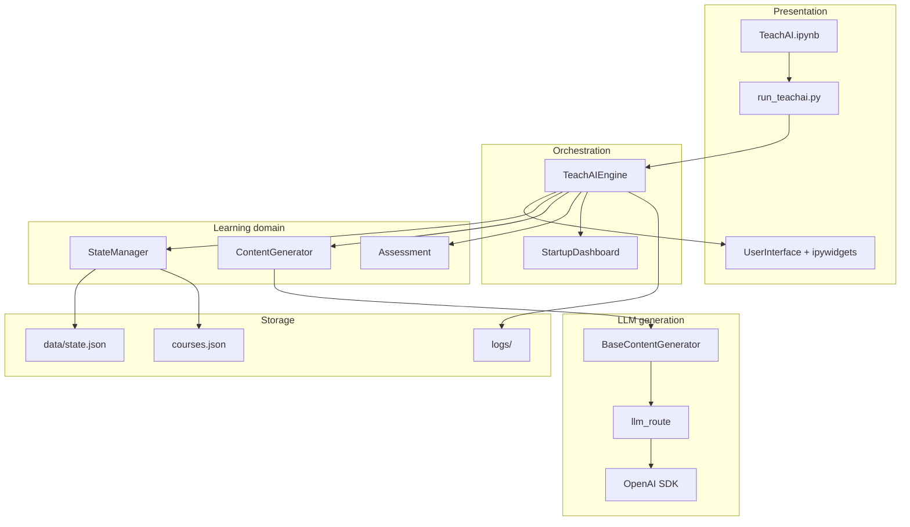

# TeachAI — Project Description (English)

This document is based on **analysis of the repository source**. Outdated descriptions are not used as sources of fact. For this refresh, the claims that were touched — startup and routes, the LLM client, practice execution, question scope, and lesson completion — were checked again against the current code. A full re-audit of every section and of the prompts was not performed.

**Russian full report:** [ОПИСАНИЕ_ПРОЕКТА_TEACHAI.md](ОПИСАНИЕ_ПРОЕКТА_TEACHAI.md)  
**Quick start:** [README.md](README.md)

---

## 1. Purpose and goals

### 1.1. Purpose

Build an **interactive AI teacher for Python and AI/ML** inside **Jupyter Notebook** (`TeachAI — интеллектуальная система персонализированного обучения Python и AI/ML на основе языковой модели`): a personalized path, generated materials, and knowledge checks, without a separate web server and without a custom trained model. The catalog covers Python, data analysis, and machine learning. A custom course title is classified by the model as inside or outside that domain. A topic outside the domain does not start by itself; the learner can start it after a warning (`course_domain_ui.gate_custom_course`). If the topic check fails, the course does not start. Executable practice runs in a child Python process (`code_sandbox.run_student_code`), not in the notebook kernel.

The purpose follows from the modules:

- `engine.py` — coordination of the TeachAI components;
- `lesson_generator.py` — generation of structured learning materials;
- `content_generator.py` — facade for lessons, questions, and user answers through OpenAI;
- `interface.py` — interaction with the learner through Jupyter Notebook.

### 1.2. Tasks implemented in code

| Task | Implementation |
|------|----------------|
| Learner profile | `SetupInterface`, `UserProfileManager` — name, study hours, lesson length, communication style |
| Catalog course or a custom title | `courses.json`, `custom_course.py`, `course_selection_ui.py` |
| Several courses in one portfolio | `course_portfolio.py` — slots in `state["courses"]`, active course mirrored at the root |
| Syllabus fitted to the learner’s time | `CoursePlanGenerator.generate_course_plan()` → saved in `state["course_plan"]` |
| Lesson body | `LessonGenerator` + `ContentFormatterFinal` |
| In-lesson interaction: questions, examples, explanations, concepts | `LessonInteraction`, `QAGenerator`, `ExamplesGenerator`, `ExplanationGenerator`, `ConceptsGenerator` |
| Question: lesson material, course subject, or outside the course | `RelevanceChecker`: `lesson` / `course` / `outside` |
| Post-lesson quiz | `Assessment`, `AssessmentGenerator`, `AssessmentInterface` |
| Practice with code checking | `ControlTasksGenerator`, `ControlTasksInterface`, `InteractiveCellWidget`, `ResultChecker` |
| Progress and return to an unfinished lesson | `LearningProgressManager`, `StartupDashboard`, `CourseDataManager.get_next_lesson()` |
| Activity logging | `Logger` → `logs/` |
| Local state | `StateManager` → `data/state.json` |

Tasks **not** implemented in the current code:

- model fine-tuning;
- a central application server (the product is a notebook client plus the OpenAI API);
- parsing external textbooks as the main content source (content is generated by the LLM from course metadata and the plan).

---

## 2. Technology stack

### 2.1. Language and runtime

- **Python 3** — `requirements.txt` does not set a lower version bound
- **Jupyter Notebook** (`TeachAI.ipynb`; dependencies `jupyter`, `ipykernel`, `ipython`)
- **IPython.display** and **ipywidgets** — the notebook UI
- The names `venv_H_L` and `venv_W_L` are examples of environments that already exist; they are not an install requirement

### 2.2. Artificial intelligence

- The client is the **`openai`** package (`openai>=1.95.1`). Calls go through `client.chat.completions.create` (`BaseContentGenerator.make_api_request` in `llm_api_base.py`). There is no separate gateway SDK.
- Default chat model: **`gpt-4o-mini`**, unless `LLM_MODEL` is set (`llm_api_base.BaseContentGenerator`).
- For part of control-task validation: **`VALIDATION_MODEL`**. If that variable is unset, the generator uses `LLM_MODEL`, and if that is unset too, `gpt-4o-mini` (`control_tasks_generator.ControlTasksGenerator.__init__`).
- The route is chosen before the learning UI (`llm_route.py`): `direct`, `gptunnel`, or `proxy`. The application proxy is required only for `proxy`. `gptunnel` is not the default: with no route source the code selects `direct`. The gateway uses `GPTUNNEL_API_KEY` and a `base_url` (`GPTUNNEL_BASE_URL` or `https://gptunnel.ru/v1`). The model name does not change with the route.

### 2.3. Configuration and data

- **python-dotenv** loads `.env`. If that file does not exist yet: `test -f .env || cp .env.sample .env`. The command does not overwrite an existing `.env` or the keys already in it.
- **JSON** — `courses.json`, `data/state.json`, logs in `logs/*.json`, and the saved route `data/llm_route_preference.json`

### 2.4. Content rendering

- **markdown**, **pygments** — markup and highlighting
- **latex2mathml** — formulas as HTML for widgets (`content_renderer.py`)
- Project modules: `content_formatter_final.py`, `content_renderer.py`. There is no `code_formatter.py` in the repository.

### 2.5. Subject libraries (examples and control tasks)

From `requirements.txt`, grouped by course:

- Data analysis: pandas, numpy, matplotlib, seaborn, scipy, openpyxl
- ML: scikit-learn, tensorflow
- Web: flask, requests
- Finance: yfinance

They are not required to import `engine.py`. They are required when student code in the child process imports them.

### 2.6. Development infrastructure

- `.pre-commit-config.yaml` — quality hooks; they are not part of a learning session
- `pytest.ini`: a normal run `python -m pytest -q` adds `-m "not live"`. The `live` marker calls the real model and is off by default. This document does not record how many tests passed. Before a full run, TeachAI and its kernel must be stopped: the `real_data_untouched` fixture in `tests/conftest.py` compares the mtime and size of `data/state.json`.
- `archive/` holds old notebooks and slides. `run_teachai.py` does not load it.

---

## 3. Architecture

### 3.1. Layers

### 3.2. Main components

| Component | File | Role |
|-----------|------|------|
| Entry point | `run_teachai.py` | `start_jupyter(api_route=...)`, `main()`, optional `reload_project_modules()` |
| Engine | `engine.py` | `TeachAIEngine`: init, start, shutdown, lesson-status check |
| Configuration | `config.py` | `.env`, `logs/` and `data/`; route choice is delegated to `llm_route.py` |
| LLM route | `llm_route.py` | `direct` / `gptunnel` / `proxy`, key for the active route, client |
| State | `state_manager.py` | Facade over profile, progress, course plan, and lesson cache |
| Generation | `content_generator.py` | Facade over 8+ generators |
| Assessment | `assessment.py` | Quizzes, answer checks, logger link |
| UI facade | `interface.py` | Screen routing |
| Dashboard | `startup_dashboard.py` | Statistics on a repeat launch |
| System log | `logger.py` | Lesson, question, quiz, and activity history |

### 3.3. StateManager

`StateManager` delegates:

- **UserProfileManager** — `state["user"]`
- **LearningProgressManager** — `state["learning"]`, lesson completion, scores, question counter
- **CourseDataManager** — `state["course_plan"]`, reading `courses.json`, navigation via `get_next_lesson()`

Further sections of `state.json` appear as the session runs:

- `lesson_content_cache` — lesson HTML and `raw_content`
- `control_tasks` — control-task results
- `system` — `first_run`, `last_access`, `version` (default `"1.0.0"`)

### 3.4. UserInterface

Interface states (`InterfaceState` in `interface_utils.py`):

`INITIAL_SETUP` → `COURSE_SELECTION` → `LESSON_VIEW` → (`ASSESSMENT` | `QUESTION_ANSWER` | …) → `COURSE_COMPLETION`

Screens:

- `SetupInterface` — profile, course choice, and the call that generates the plan
- `LessonInterface` — the lesson (delegates: `LessonDisplay`, `LessonNavigation`, `LessonInteraction`)
- `AssessmentInterface` — the quiz
- `CompletionInterface` — course completion

### 3.5. ContentGenerator

| Generator | Role |
|-----------|------|
| `CoursePlanGenerator` | JSON plan: sections → topics → lessons |
| `LessonGenerator` | Lesson text (markdown) → HTML |
| `ExamplesGenerator` | Worked examples (data + HTML) |
| `ExplanationGenerator` | A longer explanation |
| `ConceptsGenerator` | Key concepts and an explanation of one concept |
| `QAGenerator` | An answer to a lesson question |
| `AssessmentGenerator` | Quiz questions |
| `RelevanceChecker` | Levels `lesson` / `course` / `outside`; `reason` does not change the level |

Shared base: **`BaseContentGenerator`** in `llm_api_base.py` — client for the selected route, retry, HTML cleanup of the lesson for prompts, debug dumps in `debug_responses/`. `content_utils.py` only re-exports these names. It is not where the client or the default model is implemented.

---

## 4. AI teacher pipeline

### 4.1. Startup

1. The setup cell in `TeachAI.ipynb` sets `API_ROUTE` to `None` or to exactly `direct`, `gptunnel`, or `proxy`. The Start cell calls `start_jupyter(api_route=API_ROUTE)`. That choice is made before launch. It is not a widget on the learning dashboard. Other spellings are rejected by the cell.
2. `start_jupyter` clears the explicit route of the previous launch and restores the environment snapshot (`release_notebook_api_route`), then calls `load_dotenv(override=True)`.
3. `None` does not assign a route by itself. The saved preference (`data/llm_route_preference.json`, `apply_saved_route_preference`) is read only when `OPENAI_API_ROUTE` is empty. If no preference is stored, the compatible variables `OPENAI_USE_PROXY` and `OPENAI_CONNECTION_MODE` are used, then `direct`. A non-empty `OPENAI_API_ROUTE` does not open the preference file. A recognizable value sets the route (`direct` / `openai` / `vpn`, `gptunnel` / `gateway` / `tunnel`, `proxy` / `http_proxy`). An unrecognized non-empty value also skips the file and continues to those compatible variables, then `direct`.
4. An explicit `direct`, `gptunnel`, or `proxy` is applied after `.env` is loaded and overrides that chain. It is not written to `.env` or to the preference file (`set_llm_route(..., persist=False)`).
5. `TeachAIEngine()` is created and `engine.start()` is called. An LLM client is not required at this moment:
   - **Repeat launch** (`state["system"]["first_run"] == false`): `.env` and `StateManager` are checked, then `StartupDashboard` is shown. `ContentGenerator` and the client are created when the learner continues, not before the dashboard.
   - **First launch**: `initialize()` creates the generators and the client before `UserInterface.show_initial_setup()`.

`validate_llm_credentials()` is not a universal early stop. See section 7.

### 4.2. Initial setup and the course plan

1. `SetupInterface.show_initial_setup()` collects the name and the communication style (`formal` | `friendly` | `casual` | `brief`). Study hours (1–100) and lesson length (5–120 minutes) are collected on the next screen, with the course choice (`course_selection_ui.py`).
2. The profile is saved in `state["user"]`, `reset_learning_and_course_data()` runs, and `first_run` becomes `false`.
3. `show_course_selection()` offers the `courses.json` catalog **or** a custom title. If that course is already in the portfolio, it continues without generating the plan again.
4. When a **new** course is confirmed, `begin_new_course()` stores the previous slot. `ContentGenerator.generate_course_plan(course_data, total_study_hours, lesson_duration_minutes)` then:
   - sends a methodologist prompt to OpenAI with `response_format: json_object`;
   - validates and normalizes through `_validate_and_fix_course_plan`;
   - calls `save_course_plan()` into state.
5. Navigation opens the first lesson (`get_next_lesson` / handlers in `setup_interface`).

A custom title outside Python/AI/ML can start only after the warning and an explicit confirmation. `course_domain_ui.gate_custom_course` does not treat a failed topic check as permission to start.

### 4.3. Showing a lesson

Chain in `LessonDisplay.show_lesson(section_id, topic_id, lesson_id)`:

1. Cache key: `"{section_id}:{topic_id}:{lesson_id}"`.
2. Lesson metadata is loaded from `course_plan`.
3. **Cache**, in priority order:
   - `state["lesson_content_cache"]` (persistent);
   - the in-memory cache of `LessonInterface`;
   - otherwise **`LessonGenerator.generate_lesson(...)`**:
     - system: a teacher, Markdown, code in a fence tagged with the topic’s language;
     - user: course / section / topic / lesson and the communication style;
     - `make_api_request(temperature=0.7, max_tokens=3500)`;
     - `ContentFormatterFinal.format_lesson_content()` → HTML;
     - `content` and `raw_content` are stored (the raw LLM reply, before CSS).
4. `update_learning_progress()` records the current position in the course.
5. `Logger.log_lesson()` appends `logs/lesson_history.md`.
6. Widgets are built: HTML through `student_content.render_student_content()`, buttons (quiz, question, longer explanation, examples, control task), and navigation.

Automatic insertion of interactive cells through `cell_integration` in `lesson_display.py` is **disabled** (`CELLS_INTEGRATION_AVAILABLE = False`). Control tasks are shown through `ControlTasksInterface`.

### 4.4. Learner question (Q&A)

The button handler is `LessonInteraction.setup_enhanced_qa_container`. The counter is not incremented before the check. There is no local stem-word heuristic; the model decides.

1. `check_question_relevance(...)` prepares the lesson text: it strips the “course / section / topic” header, cleans HTML, and applies a character limit. The course title and the plan description are passed as a separate block. The topic title is not substituted for the course title.
2. Expected JSON: `scope` (`lesson` | `course` | `outside`), `is_relevant`, `confidence`, `reason`, `suggestions`. A recognizable `scope` wins over a conflicting `is_relevant`. Words in `reason` do not change the level.
3. `outside`: refusal “Вопрос вне курса”, `increment_offtopic_count`. No on-topic answer is generated.
4. `lesson`: a normal answer from `QAGenerator.answer_question`, then `increment_questions_count`.
5. `course`: the same answer, plus a yellow note that this is not the lesson topic but is still a course question. The question counter is the same one used for `lesson`.

A bad classifier reply is not one automatic accept and not one automatic refusal:

- Text from which `parse_llm_json` cannot extract JSON: `check_question_relevance` raises «Не удалось проверить релевантность вопроса». The button shows «Ошибка при генерации ответа». Counters do not grow. This is not an automatic accept.
- A parsed object with no recognizable `scope` follows `is_relevant`. If the field is missing, already `false`, or a string other than `true` / `1` / `yes` / `да`, the level is `outside` and the question is refused. A true value (`true` or one of those strings) becomes `lesson`.
- A parsed value that has no object fields (a list, a number, or `null`) hits the exception path in `_extract_relevance_from_response`, and the fallback result is `scope=lesson`. Only this branch accepts a question because of the shape of the reply. A missing JSON object and an object without a recognizable `scope` do not take this path.

The lesson-question button does not call `ContentGenerator.get_formatted_answer_with_relevance()` or `append_question_reminder` (the reminder after the third question). The reminder still lives on that facade method; the repository has no call of the method. Stand-in tests check this parse contract. They do not measure how accurately the live model classifies questions.

### 4.5. Other actions on the lesson

| Action | Call |
|--------|------|
| Full explanation | `get_detailed_explanation` |
| Key concepts | `generate_concepts` / `extract_key_concepts` (cache in `current_lesson_concepts`) |
| Explain one concept | `explain_concept` |
| Examples | `generate_examples_data` → `examples_display` widgets |

### 4.6. Quiz (assessment)

1. `AssessmentInterface` → `Assessment.generate_questions` → `AssessmentGenerator` (lesson content, about 4000 characters of cleaned text).
2. The learner answers in the UI. `Assessment.check_answer` compares the selected option index.
3. The score is 0–100%. **A passing quiz is score > 40%** (`assessment_results_handler.py`, `LearningProgressManager.is_test_passed`).
4. `save_lesson_assessment`, `Logger.log_assessment`.

The quiz **by itself does not complete the lesson**. `is_lesson_completed` still requires a correct control task, or a separate forced mark. A confirmed skip of the quiz is not completion either.

### 4.7. Control task

1. `ControlTasksGenerator` builds the task (description, starter code, reference solution, check type).
2. The “run code” button and the check in `ControlTasksInterface`, examples in `examples_display`, and the interactive cell (`execute_student_code` in `interactive_cell_logic.py`) call `code_sandbox.run_student_code`. That is a child process: `stdin` is closed, the working directory is temporary and then removed, and the environment is an allowlist. Inside the worker, the code runs through `exec`. The notebook kernel does not call that `exec`. `execute_student_code` delegates to `run_student_code`. The result is compared by `ResultChecker` (exact, numeric, list, function, object, output, and others).
3. Stdout is inserted into HTML already escaped (`format_execution_stdout_html`), so text such as `<class 'int'>` is not swallowed as a tag.
4. This is a process limit, not protection against arbitrary code.
5. For sklearn code, `random_state` is stabilized (`stabilize_sklearn_code`).
6. Success → `StateManager.save_control_task_result(lesson_id, ..., is_correct=True)`.
7. `ControlTasksLogger` stores attempt statistics by `cell_id`.

### 4.8. Lesson completion and what comes next

`LearningProgressManager.is_lesson_completed(lesson_id)`:

- `True` if the lesson is marked forcibly (`lesson_completion_status`), **or** the control task is correct (`control_tasks.is_correct`) **and at least one of these holds:** the quiz is **> 40%**, or the learner confirmed moving to the control task without a quiz (`control_task_bypass`). The bypass alone does not complete the lesson and does not cancel a correct control task. Entering the control task without a quiz is a separate confirmation (`lesson_control_access.py`). It is not the same thing as completion.
- `CourseDataManager.get_next_lesson()` returns the current unfinished lesson or the next one in the plan.
- The lesson map (`lesson_outline.py`) allows moves to completed lessons, the current lesson, and the next unfinished lesson.
- `TeachAIEngine._check_current_lesson_status()` returns the learner to an unfinished lesson at start.
- After every lesson is done, `CompletionInterface.show_course_completion()` runs.

---

## 5. Key modules (reference)

### 5.1. Core and startup

- **`run_teachai.py`** — single entry point, module reload order for Jupyter development, `api_route` argument.
- **`engine.py`** — lifecycle, logs in `logs/teachai.log`.
- **`llm_route.py`** — route priority, client, and a key/proxy check only for the selected route.
- **`config.py`** — loads `.env` and directories; route selection is delegated to `llm_route.py`.

### 5.2. Generation and formatting

- **`llm_api_base.py`** — `BaseContentGenerator`, `make_api_request`, `make_api_request_with_retries`.
- **`content_utils.py`** — compatibility facade: re-exports names from `llm_json`, `llm_api_base`, `communication_style`, `qa_response_utils`, and the client from `llm_route`. Not the main API client.
- **`lesson_generator.py`** — lesson prompt in Markdown; code is requested in fenced blocks with a language tag, and the whole lesson is not wrapped in one fence.
- **`course_plan_generator.py`** — JSON course plan.
- **`student_content.py`** — display canon: Markdown/HTML → HTML for ipywidgets.
- **`content_formatter_final.py`** — fences become `<pre>`; the rest goes through the canon.
- **`content_renderer.py`** — tables, LaTeX→MathML, `enhance_content`, `render_markdown_to_html`.
- **`examples_*.py`** — generation, validation, and code cleanup (`examples_code_fixes.py`), plus display.
- **`qa_generator.py`**, **`explanation_generator.py`**, **`concepts_generator.py`**, **`relevance_checker.py`**, **`assessment_generator.py`**.

### 5.3. Interface

- **`interface.py`**, **`interface_utils.py`** — facade and styles.
- **`setup_interface.py`**, **`lesson_interface.py`**, **`lesson_display.py`**, **`lesson_outline.py`**, **`lesson_navigation.py`**, **`lesson_interaction.py`**, **`lesson_utils.py`**.
- **`assessment_interface.py`**, **`assessment_results_handler.py`**, **`completion_interface.py`**.
- **`control_tasks_interface.py`**, **`loading_indicators.py`** — UX during long API calls.

### 5.4. Practice and checking

- **`control_tasks_generator.py`** — generates and validates tasks, including with the LLM.
- **`code_sandbox.py`** — child process for examples, control tasks, and interactive cells.
- **`result_checker.py`** — compares execution results.
- **`interactive_cell_widget.py`**, **`interactive_cell_logic.py`**, **`interactive_cell_ui.py`**, **`cell_widget_base.py`**. `execute_student_code` delegates to `run_student_code`.

### 5.5. Data and progress

- **`courses.json`** — static catalog of five courses:

| ID | Title |
|----|-------|
| `python-basics` | Основы Python |
| `data-analysis` | Анализ данных с Python |
| `machine-learning` | Введение в машинное обучение |
| `web-development` | Веб-разработка на Python |
| `python-for-finance` | Python для финансов |

- **`custom_course.py`**, **`course_selection_ui.py`**, **`course_domain.py`** — catalog or a custom title; whether the topic belongs to Python/AI/ML is asked of the LLM. Outside the domain, the UI warns and offers a forced start.
- **`project_identity.py`** — title and subject-domain frame on the first screen.
- **`course_portfolio.py`**, **`course_portfolio_ui.py`** — several courses in `state.json` (start another without wiping, switch, delete).
- **`user_profile_manager.py`**, **`learning_progress_manager.py`**, **`course_data_manager.py`**.

---

## 6. Implementation choices

These points name **concrete decisions in the code**, not marketing claims.

1. **Facades** — `ContentGenerator` and `UserInterface` keep a backward-compatible API while the logic lives in separate files (comments in `content_generator.py`, `interface.py`).

2. **Two-level lesson cache** — the session memory plus `lesson_content_cache` in `state.json` avoids repeating expensive OpenAI calls when a lesson is opened again (`lesson_display.py`, `state_manager.py`).

3. **`content` and `raw_content`** — formatted HTML for display, raw markdown for LLM analysis (relevance, concepts), without leaking CSS into prompts (`lesson_generator.py`, `prepare_lesson_text_for_analysis`).

4. **Three question levels** — `lesson`, `course`, and `outside`. The lesson header is stripped, and the course subject is passed separately. `reason` does not rewrite the level. This is the model’s decision. Classifier accuracy is not measured in this repository (`relevance_checker.py`).

5. **Combined mastery check** — a lesson is complete when it is marked forcibly, **or** the control task is correct **and at least one condition holds:** quiz > 40%, or a confirmed move to the control task without a quiz. Entering the control task without a quiz (`lesson_control_access.py`) does not by itself close the lesson (`learning_progress_manager.is_lesson_completed`).

6. **Personalization** — communication style in the prompts of the generators (`ContentUtils.COMMUNICATION_STYLES`), the learner’s name in the lesson, and a plan fitted to the given hours and lesson length.

7. **Retries** — `make_api_request_with_retries` with exponential backoff (`llm_api_base.py`). This does not promise that the network path to the API is available.

8. **Observability** — structured logs: `activity_log.json`, `questions_log.json`, `assessment_log.json`, `lesson_history.md` (`logger.py`).

9. **Lazy start** — on a repeat launch the dashboard is shown first. Heavy initialization runs on the continue-learning button (`engine.py`, `startup_dashboard.py`).

10. **Learning content in Jupyter** — LaTeX and Markdown tables are converted for `widgets.HTML`, where MathJax is not available (`content_renderer.py`).

11. **Reproducible ML practice** — `random_state` is fixed in typical sklearn calls during checking (`control_tasks_generator.py`).

---

## 7. Limitations and dependencies (from code)

- The active route needs its own key and settings: `OPENAI_API_KEY` for `direct` and `proxy`, a proxy URL only for `proxy`, and `GPTUNNEL_API_KEY` for `gptunnel`. A proxy or VPN is not required for every route. The code does not guarantee that the network can reach the API. When a missing value is noticed depends on the launch path. In `start_jupyter`, `validate_llm_credentials()` runs before `TeachAIEngine` only if a `.env` file already exists. Without that file the check is skipped, and `TeachAIEngine._initialize_basic_components` reports the missing `.env`. `python run_teachai.py` has no such check in `main()`: `validate_llm_credentials()` is called from `ConfigManager.load_config()` during `initialize()`, and a missing `.env` is reported earlier, in `TeachAIEngine.initialize`. Creating the client (`create_openai_client`) is a separate step: it requires the key, and for `proxy` also the URL. On a repeat launch the client is created when the learner continues.
- The quality and factual correctness of materials are determined by the **external LLM**. There is no separate verifier of teaching truth for a whole lesson. Accuracy of the `lesson` / `course` / `outside` levels is not measured by this repository.
- Student code is limited by a child process (closed `stdin`, a temporary directory, an environment allowlist). That is not a promise of full isolation and not production sandbox security.
- State stays **on the learner’s machine**. Sync across devices is not implemented.
- `cell_integration` in the lesson flow is **off**: an import may set the flag, and then `lesson_display.py` forces `CELLS_INTEGRATION_AVAILABLE = False`.
- A custom topic outside Python/AI/ML is not blocked forever: after the warning there is a confirmed start. A failed topic check does not open that start.

---

## 8. Related documents

| File | Language | Role |
|------|----------|------|
| `README.md` | Russian | Short practical guide |
| `ОПИСАНИЕ_ПРОЕКТА_TEACHAI.md` | Russian | Full report for the committee and reviewers |
| `DESCRIPTION.md` | English | The same facts for readers who need English |

- Short overview and setup: [README.md](README.md)
- Russian full report: [ОПИСАНИЕ_ПРОЕКТА_TEACHAI.md](ОПИСАНИЕ_ПРОЕКТА_TEACHAI.md)

The two long reports exist for **audience and language**. They describe one project.

---

*Description aligned with the TeachAI codebase. Affected claims were rechecked against source. A full re-audit of every section and of the prompts was not performed.*
