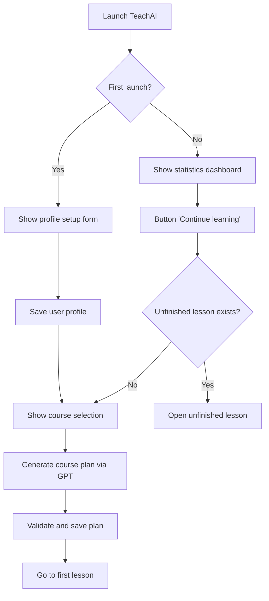
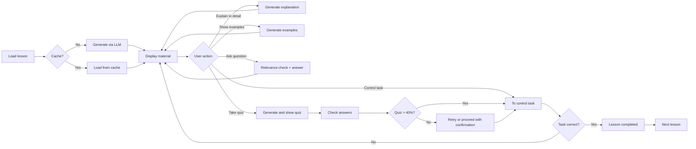

# TeachAI — Intelligent Personalized Learning System

This document is based on **source code analysis** of the repository. Outdated descriptions are not used as sources of fact. The description relies on source code analysis; during this refresh, claims that were touched have been checked; a complete re-audit of all sections was not performed.

**Note:** This is a working English version based on the detailed Russian documentation ([ОПИСАНИЕ_ПРОЕКТА_TEACHAI.md](ОПИСАНИЕ_ПРОЕКТА_TEACHAI.md)). Root-level copies (`../README.md`, `../DESCRIPTION.md`, `../ОПИСАНИЕ_ПРОЕКТА_TEACHAI.md`) are maintained separately.

---

## 📋 Table of Contents

1. [Project Overview](#project-overview)
2. [Purpose and Goals](#purpose-and-goals)
3. [Key Ideas and Concepts](#key-ideas-and-concepts)
4. [System Architecture](#system-architecture)
5. [System Logic](#system-logic)
6. [Modular Structure](#modular-structure)
7. [GPT Model Usage](#gpt-model-usage)
8. [State and Data Management](#state-and-data-management)
9. [Interactive Interface](#interactive-interface)
10. [Technology Stack](#technology-stack)
11. [Implementation Features](#implementation-features)
12. [Model Fine-Tuning Question](#model-fine-tuning-question)
13. [Usage Examples](#usage-examples)

---

## Project Overview

**TeachAI** is an intelligent educational platform operating in the Jupyter Notebook environment and using the OpenAI GPT API for automatic generation of personalized learning materials.

The system can:
- 📚 Create complete learning plans tailored to learning parameters
- 📖 Generate detailed lessons with theory, examples, and code
- 🧪 Create quizzes to assess material comprehension
- ❓ Answer student questions about lesson content
- 📊 Track learning progress and statistics
- 🎯 Adapt communication style to user preferences

---

## Purpose and Goals

### Main Goal

Build an **interactive AI teacher for Python and AI/ML** in **Jupyter Notebook**: a personalized learning path, content generation, and knowledge assessment without a separate web server and without training a custom model. The course catalog covers Python, data analysis, and machine learning. A custom course title is classified by the model as belonging to this domain or not: outside the domain, a course does not start automatically, but can be started after a warning (`course_domain_ui.gate_custom_course`). If the topic validation fails, the course does not start. Executable practice runs in a child Python process (`code_sandbox.run_student_code`), not in the notebook kernel.

The purpose follows from module designations:

- `engine.py` — "coordination of all TeachAI system components";
- `lesson_generator.py` — generation of "structured educational materials";
- `content_generator.py` — generation facade for "lessons, questions, and user answer processing" through OpenAI;
- `interface.py` — "user interaction through Jupyter Notebook".

### Project Tasks (Implemented in Code)

| Task | Implementation |
|------|----------------|
| Learner profile | `SetupInterface`, `UserProfileManager` — name, study hours, lesson duration, communication style |
| Course selection from catalog or custom title | `courses.json`, `custom_course.py`, `course_selection_ui.py` |
| Portfolio of multiple courses | `course_portfolio.py` — slots in `state["courses"]`, active course mirrored at root |
| Learning plan tailored to user time | `CoursePlanGenerator.generate_course_plan()` → saved in `state["course_plan"]` |
| Lesson content generation | `LessonGenerator` + `ContentFormatterFinal` |
| In-lesson interaction: questions, examples, explanations, concepts | `LessonInteraction`, `QAGenerator`, `ExamplesGenerator`, `ExplanationGenerator`, `ConceptsGenerator` |
| Question: lesson material, course subject, or outside course | `RelevanceChecker`: `lesson` / `course` / `outside` |
| Post-lesson testing | `Assessment`, `AssessmentGenerator`, `AssessmentInterface` |
| Practice with code checking | `ControlTasksGenerator`, `ControlTasksInterface`, `InteractiveCellWidget`, `ResultChecker` |
| Progress tracking and return to unfinished lesson | `LearningProgressManager`, `StartupDashboard`, `CourseDataManager.get_next_lesson()` |
| Action logging | `Logger` → `logs/` |
| Local state storage | `StateManager` → `data/state.json` |

Tasks **not** implemented in current code (for project scope clarity):

- model fine-tuning;
- centralized application server (notebook client + OpenAI API only);
- parsing external textbooks as the primary content source (content is generated by LLM from course metadata and plan).

### Target Audience

- Students learning programming independently
- Teachers needing tools for rapid material preparation
- Educational platforms wanting to automate content creation

---

## Key Ideas and Concepts

### 1. Prompt Engineering Instead of Fine-Tuning

**Central idea:** using an off-the-shelf GPT model through carefully crafted prompts instead of fine-tuning.

**Approach advantages:**
- ⚡ Quick deployment without model training
- 🔄 Ability to adapt to topics from Python/AI/ML domain
- 💰 Resource savings (no GPU or dataset costs)
- 📈 OpenAI base model updates can improve results

### 2. Facade Architecture

**Principle:** separation of concerns through specialized generator modules.

```
ContentGenerator (facade)
    ├── CoursePlanGenerator    → course plans
    ├── LessonGenerator         → lesson content
    ├── ExamplesGenerator       → practical examples
    ├── AssessmentGenerator     → quizzes and questions
    ├── QAGenerator             → question answers
    ├── ConceptsGenerator       → key concepts
    ├── ControlTasksGenerator   → control tasks
    └── RelevanceChecker        → relevance checking
```

### 3. Multi-Level Validation

**Concept:** different validation checks are applied to different types of generated content. The validation set depends on the specific generator.

1. **Structural validation**: JSON schema checks, required field presence (for course plans, quizzes)
2. **Semantic validation**: content relevance to topic (for questions, answers)
3. **Format validation**: code and markdown correctness (for lessons, examples)
4. **Auto-correction**: fixing common errors and regeneration as needed (for course plans)

### 4. State Persistence

**Idea:** persistent storage of learning progress in a local JSON file.

Stored:
- User profile (name, communication style, learning parameters)
- Current progress (current lesson, completed lessons)
- Quiz results (scores, attempts, statistics)
- Course plan (structure of sections, topics, and lessons)
- Lesson cache (`lesson_content_cache`)

---

## System Architecture

### Architectural Diagram

```
┌─────────────────────────────────────────────────────────────┐
│                    TeachAI Engine (Orchestrator)             │
│  - Component initialization                                  │
│  - Workflow coordination                                     │
│  - Lifecycle management                                      │
└─────────────┬───────────────────────────────────────────────┘
              │
      ┌───────┴────────┬──────────────┬─────────────┬──────────┐
      │                │              │             │          │
┌─────▼─────┐  ┌──────▼──────┐  ┌───▼────┐  ┌─────▼────┐  ┌─▼────────┐
│  Config   │  │    State    │  │Content │  │Interface │  │Assessment│
│  Manager  │  │   Manager   │  │Generator│  │          │  │          │
└───────────┘  └──────┬──────┘  └────────┘  └──────────┘  └──────────┘
                      │
          ┌───────────┼───────────┐
          │           │           │
    ┌─────▼─────┐ ┌──▼──────┐ ┌─▼────────┐
    │  User     │ │Learning │ │  Course  │
    │  Profile  │ │Progress │ │   Data   │
    └───────────┘ └─────────┘ └──────────┘
```

### Key Components

| Component | File | Purpose |
|-----------|------|---------|
| **TeachAIEngine** | `engine.py` | Main orchestrator: init, start, shutdown, lesson check |
| **ConfigManager** | `config.py` | Configuration management `.env`, `logs/` and `data/` directories; route selection delegated to `llm_route.py` |
| **LLM Route** | `llm_route.py` | Route `direct` / `gptunnel` / `proxy`, active route key, client |
| **StateManager** | `state_manager.py` | Facade over profile, progress, course plan, lesson cache |
| **ContentGenerator** | `content_generator.py` | Facade over 8+ generators |
| **UserInterface** | `interface.py` | Interactive UI facade, screen routing |
| **Assessment** | `assessment.py` | Knowledge assessment, answer checking, logger link |
| **StartupDashboard** | `startup_dashboard.py` | Statistics on repeat launch |
| **Logger** | `logger.py` | Lesson, question, quiz, activity history |

### StateManager Specialization

`StateManager` delegates to:

- **UserProfileManager** — `state["user"]`
- **LearningProgressManager** — `state["learning"]`, lesson completion, scores, question counter
- **CourseDataManager** — `state["course_plan"]`, `courses.json` reading, `get_next_lesson()` navigation

Additional `state.json` sections (created as work progresses):

- `lesson_content_cache` — lesson HTML and `raw_content`
- `control_tasks` — control task results
- `courses` — multi-course portfolio (`course_portfolio.py`)
- `system` — `first_run`, `last_access`, `version` (default `"1.0.0"`)

### UserInterface Specialization

Interface states (`InterfaceState` in `interface_utils.py`):

`INITIAL_SETUP` → `COURSE_SELECTION` → `LESSON_VIEW` → (`ASSESSMENT` | `QUESTION_ANSWER` | …) → `COURSE_COMPLETION`

Screen implementations:

- `SetupInterface` — profile and course selection + plan generation call
- `LessonInterface` — lesson (delegates: `LessonDisplay`, `LessonNavigation`, `LessonInteraction`)
- `AssessmentInterface` — quiz
- `CompletionInterface` — course completion

### ContentGenerator Specialization

| Generator | Purpose |
|-----------|---------|
| `CoursePlanGenerator` | JSON plan: sections → topics → lessons |
| `LessonGenerator` | Lesson text (markdown) → HTML |
| `ExamplesGenerator` | Practical examples (data + HTML) |
| `ExplanationGenerator` | Extended explanation |
| `ConceptsGenerator` | Key concepts and concept explanation |
| `QAGenerator` | Answer to lesson question |
| `AssessmentGenerator` | Quiz questions |
| `ControlTasksGenerator` | Control tasks with code checking |
| `RelevanceChecker` | Levels `lesson` / `course` / `outside`; `reason` doesn't change level |

Common base: **`BaseContentGenerator`** in `llm_api_base.py` — selected route client, retry, lesson HTML cleanup for prompts, debug dumps in `debug_responses/`. `content_utils.py` only re-exports these names.

---

## System Logic

### First Launch Scenario



### Lesson Lifecycle

**Note:** The diagram shows one typical scenario. The actual logic allows:
- proceeding to control task without completing the quiz (with confirmation);
- manual forced lesson completion;
- generating lesson from cache (bypassing LLM regeneration).



### AI-Teacher Pipeline: From Launch to Response

#### 1. System Launch and API Route Selection

1. **Setup cell in TeachAI.ipynb**: `API_ROUTE = None` or exactly `direct`, `gptunnel`, or `proxy`. This is a choice **before** launching the learning interface, not a widget on the dashboard. Other spellings are not accepted by the cell.

2. **Start cell**: `start_jupyter(api_route=API_ROUTE)` releases the explicit route from the previous launch, then `load_dotenv(override=True)`.

3. **Route selection chain** (`llm_route.py`):
   - `None` does not assign a route itself
   - **If `OPENAI_API_ROUTE` is NON-empty:**
     - recognized value (`direct`, `gptunnel`, `proxy`) → applied
     - unrecognized → skips preference, goes to legacy variables, then `direct`
   - **If `OPENAI_API_ROUTE` is empty:**
     - file `data/llm_route_preference.json` (if present)
     - otherwise legacy `OPENAI_USE_PROXY` and `OPENAI_CONNECTION_MODE`
     - otherwise `direct`

4. **Explicit `direct`, `gptunnel`, `proxy`** in the cell are set after loading `.env` and override the chain above. They are not written to `.env` or preference.

5. **Route requirements**:
   - `direct` — `OPENAI_API_KEY`
   - `gptunnel` — `GPTUNNEL_API_KEY` and `GPTUNNEL_BASE_URL` (or `https://gptunnel.ru/v1`)
   - `proxy` — `OPENAI_API_KEY` and URL in `OPENAI_PROXY` / `HTTPS_PROXY` / `HTTP_PROXY`

6. **`TeachAIEngine()` initialization**:
   - **Repeat launch**: `.env` and `StateManager` check, `StartupDashboard` display. `ContentGenerator` and client are created when "Continue learning" is pressed.
   - **First launch**: `initialize()` creates generators and client before `UserInterface.show_initial_setup()`.

#### 2. Initial Setup and Course Plan

1. `SetupInterface.show_initial_setup()` — form: name, study hours (1–100), lesson duration (5–120 min), style (`formal` | `friendly` | `casual` | `brief`).
2. Save to `state["user"]`, `reset_learning_and_course_data()`, `first_run = false`.
3. `show_course_selection()` — catalog `courses.json` **or** custom title. When confirming a **new** course, Python/AI/ML domain membership is checked (`course_domain.py`): outside domain — warning and forced start option; check error — start blocked. If course is already in portfolio — continue without regenerating plan.
4. `ContentGenerator.generate_course_plan(course_data, total_study_hours, lesson_duration_minutes)`:
   - methodologist prompt → OpenAI with `response_format: json_object`;
   - validation/normalization `_validate_and_fix_course_plan`;
   - `save_course_plan()` to state.

#### 3. Lesson Display

Chain in `LessonDisplay.show_lesson(section_id, topic_id, lesson_id)`:

1. Cache key: `"{section_id}:{topic_id}:{lesson_id}"`.
2. Load lesson metadata from `course_plan`.
3. **Cache** (priority order):
   - `state["lesson_content_cache"]` (persistent);
   - in-memory cache `LessonInterface`;
   - otherwise **`LessonGenerator.generate_lesson(...)`**:
     - system: teacher, Markdown, code in ```lang of topic language;
     - user: prompt with course/section/topic/lesson and style;
     - `make_api_request(temperature=0.7, max_tokens=3500)`;
     - `ContentFormatterFinal.format_lesson_content()` → HTML;
     - save `content` + `raw_content` (raw LLM response before CSS).
4. `update_learning_progress()`, `Logger.log_lesson()`.
5. Widget assembly: HTML via `student_content.render_student_content()`, buttons, navigation.

**Note:** automatic interactive cell insertion via `cell_integration` in `lesson_display.py` is **disabled** (`CELLS_INTEGRATION_AVAILABLE = False`).

#### 4. User Question (Q&A)

Button handler in `LessonInteraction.setup_enhanced_qa_container`. Counter is not incremented before checking. No local heuristics by word roots: the model makes the decision.

1. **`check_question_relevance(...)`** prepares lesson text: strips "course / section / topic" header, HTML cleanup, character limit. **Course name and plan description are passed as a separate block**. Topic name is not substituted for course name.

2. **Expected JSON**: `scope` (`lesson` | `course` | `outside`), `is_relevant`, `confidence`, `reason`, `suggestions`. **Recognized `scope` overrides contradicting `is_relevant`**. Words in `reason` do not change level.

3. **Three processing levels**:
   - `outside`: refuse "Question outside course", `increment_offtopic_count`. Topic answer not generated.
   - `lesson`: normal answer `QAGenerator.answer_question`, then `increment_questions_count`.
   - `course`: same answer and yellow note that this is not the lesson topic, but a course question; same question counter.

4. **Incorrect classifier response** — three different branches:
   - Text from which `parse_llm_json` cannot extract JSON: `check_question_relevance` raises "Failed to check question relevance". Button shows "Error generating answer", counters don't grow.
   - Parsed object without recognized `scope`: level taken from `is_relevant`. Field absent, value already `false`, or string not from `'true'` / `'1'` / `'yes'` / `'да'` — level `outside` and refuse. Truth (`true` or such string) — `lesson`.
   - Parsed value without object fields (list, number, `null`): exception in `_extract_relevance_from_response`, fallback result `scope=lesson`.

#### 5. Quiz (assessment)

1. `Assessment.generate_questions` → `AssessmentGenerator` (lesson content, ~4000 characters of cleaned text).
2. `Assessment.check_answer` compares option index.
3. **Quiz passing: score > 40%** (`assessment_results_handler.py`).
4. `save_lesson_assessment`, `Logger.log_assessment`.

**Quiz by itself does not complete the lesson**.

#### 6. Control Task

1. `ControlTasksGenerator` generates task (description, starter code, reference, check type).
2. Execution calls `code_sandbox.run_student_code` — **child process**: `stdin` closed, temporary directory then deleted, allowlist environment. Inside the worker process, code executes via `exec`; the notebook kernel does not call this `exec`. Result comparison — `ResultChecker`.
3. stdout output is escaped (`format_execution_stdout_html`).
4. **This is process restriction, not production-grade security against arbitrary code.**
5. Success → `StateManager.save_control_task_result(lesson_id, ..., is_correct=True)`.

#### 7. Lesson Completion

`LearningProgressManager.is_lesson_completed(lesson_id)`:

- `True` if lesson marked forced complete (`lesson_completion_status`), **or** control task completed correctly (`control_tasks.is_correct`) **and at least one condition met:** quiz **> 40%** or confirmed bypass to control task without quiz (`control_task_bypass`).
- Confirmed quiz bypass itself does not complete lesson and does not cancel control task.
- After all lessons passed — `CompletionInterface.show_course_completion()`.

---

## Modular Structure

### 1. System Core

| Module | Description |
|--------|-------------|
| `engine.py` | Main TeachAIEngine class, initialization and coordination, logs in `logs/teachai.log` |
| `run_teachai.py` | Single entry point, module reload order, `api_route` argument |
| `config.py` | Configuration management (`.env`, API keys, directories); route selection delegated to `llm_route.py` |
| `llm_route.py` | Route priority, client, key and proxy check only for selected route |
| `logger.py` | System action logging: `activity_log.json`, `questions_log.json`, `assessment_log.json`, `lesson_history.md` |

### 2. State Management

| Module | Description |
|--------|-------------|
| `state_manager.py` | Base state manager (coordinator) |
| `user_profile_manager.py` | User profile management |
| `learning_progress_manager.py` | Learning progress tracking |
| `course_data_manager.py` | Course data management, `get_next_lesson()` navigation |

### 3. Content Generation

| Module | Description |
|--------|-------------|
| `content_generator.py` | **Facade** for all content generators |
| `llm_api_base.py` | `BaseContentGenerator`, `make_api_request`, retry logic |
| `content_utils.py` | Compatibility facade: re-exports to `llm_json`, `llm_api_base`, `communication_style`, `qa_response_utils` and client from `llm_route` |
| `course_plan_generator.py` | Course plan generation |
| `lesson_generator.py` | Lesson content generation |
| `examples_generator.py` | Practical example generation |
| `explanation_generator.py` | Detailed explanations |
| `assessment_generator.py` | Quiz and question generation |
| `qa_generator.py` | Student question answers |
| `concepts_generator.py` | Key concept extraction |
| `relevance_checker.py` | Question relevance checking (`lesson` / `course` / `outside`) |
| `control_tasks_generator.py` | Control task generation |

### 4. User Interface

| Module | Description |
|--------|-------------|
| `interface.py` | Interface **facade** |
| `interface_utils.py` | UI element creation utilities |
| `setup_interface.py` | Profile setup and course selection |
| `lesson_interface.py` | Lesson display |
| `lesson_display.py` | Lesson content visualization |
| `lesson_navigation.py` | Lesson navigation |
| `lesson_interaction.py` | Interactive functions (explanations, examples, Q&A) |
| `lesson_utils.py` | Lesson utilities |
| `lesson_outline.py` | Lesson map with transitions |
| `assessment_interface.py` | Quiz interface |
| `assessment_results_handler.py` | Quiz result processing |
| `completion_interface.py` | Course completion screen |
| `startup_dashboard.py` | Statistics dashboard on startup |
| `loading_indicators.py` | Loading indicators for long API requests |

### 5. Assessment & Practice

| Module | Description |
|--------|-------------|
| `assessment.py` | Answer checking and score calculation |
| `control_tasks_interface.py` | Control task interface |
| `result_checker.py` | Solution correctness checking (exact, numeric, list, function, output, etc.) |
| `code_sandbox.py` | Child process for examples, control tasks, and interactive cells |
| `interactive_cell_widget.py` | Code editor widget |
| `interactive_cell_logic.py` | Code execution logic via `run_student_code` |
| `interactive_cell_ui.py` | Interactive cell UI |
| `cell_widget_base.py` | Base class for cell widgets |

### 6. Formatting and Validation

| Module | Description |
|--------|-------------|
| `content_formatter_final.py` | Final content formatting: fences → `<pre>`, rest via canon |
| `content_renderer.py` | Tables, LaTeX→MathML, `enhance_content`, `render_markdown_to_html` |
| `student_content.py` | Display canon: Markdown/HTML → HTML for ipywidgets |
| `examples_validation.py` | Practical example validation |
| `examples_code_fixes.py` | Example code sanitization |
| `examples_display.py` | Example display |

### 7. Courses and Portfolio

| Module | Description |
|--------|-------------|
| `courses.json` | Static catalog (5 courses) |
| `custom_course.py` | Custom course logic |
| `course_selection_ui.py` | Course selection UI |
| `course_domain.py` | Python/AI/ML domain membership check |
| `course_domain_ui.py` | Out-of-domain start confirmation UI (`gate_custom_course`) |
| `project_identity.py` | Project name and domain scope on first screen |
| `course_portfolio.py` | Multiple courses in `state.json` (new start without wipe, switching, deletion) |
| `course_portfolio_ui.py` | Course portfolio UI |

---

## GPT Model Usage

---

**⚠️ About Code Examples in This Document:**

All code fragments below are **simplified illustrations** and **conceptual schematics** demonstrating the system's logic and patterns. They are not intended for literal copying and execution. Function names may be conventional designations. For exact launch commands and current implementation, refer to the repository source code and the `run_teachai.py` file.

---

### API Usage Approach

```python
# Conceptual example of OpenAI API usage pattern

class BaseContentGenerator:
    def __init__(self, api_key):
        # Client created via llm_route
        self.client = get_client_from_route()  # conceptually: llm_route.get_openai_client()

    def make_api_request(self, messages, temperature=0.7,
                         max_tokens=3500, response_format=None):
        """Uniform OpenAI API call"""
        response = self.client.chat.completions.create(
            model=get_model_from_env(),  # conceptually: config.LLM_MODEL or 'gpt-4o-mini'
            messages=messages,
            temperature=temperature,
            max_tokens=max_tokens,
            response_format=response_format
        )
        return response.choices[0].message.content
```

### Prompt Types

#### 1. System Prompts

Define role and behavior of the model:

```python
{
    "role": "system",
    "content": "You are an experienced Python instructor. Create detailed lessons WITHOUT final farewells."
}
```

#### 2. User Prompts

Contain specific task with detailed instructions:

```python
prompt = f"""
🚨 CRITICAL API INSTRUCTION! 🚨

Create an educational lesson on:
Course: {course}
Topic: {topic}

IMPORTANT REQUIREMENTS:
1. ALL code examples must be in Python
2. Code must be properly formatted
3. Each line of code on separate line
4. Use markdown blocks: ```python ... ```

Lesson should contain:
- Topic introduction
- Core concepts
- Practical examples
- Brief conclusion
"""
```

### Quality Enhancement Strategies

#### 1. Emoji Markers in Prompts

```python
# Drawing model attention to critical requirements
"""
🚨 CRITICALLY IMPORTANT! 🚨
⚠️ MANDATORY REQUIREMENT! ⚠️
"""
```

#### 2. Repeated Requirements

```python
"""
THIS IS A PYTHON COURSE! ALL CODE EXAMPLES MUST BE IN PYTHON!
...
🚨 THIS IS A PYTHON COURSE! 🚨
...
MUST USE PYTHON!
"""
```

#### 3. Correct and Incorrect Formatting Examples

````python
"""
CORRECT:
```python
count = 0
while count < 5:
    print(count)
    count += 1
```

INCORRECT (DON'T DO THIS!):
```python
count = 0 while count < 5: print(count) count += 1
```
"""
````

#### 4. Response Format Specification

```python
response = self.make_api_request(
    messages=messages,
    response_format={"type": "json_object"}  # Require JSON
)
```

### Response Processing

```python
def process_gpt_response(response_content, content_type):
    # 1. Parsing (if JSON)
    if content_type == "course_plan":
        data = json.loads(response_content)

    # 2. Structure validation
    if not validate_structure(data):
        raise ValidationError("Invalid structure")

    # 3. Cleanup from markdown markers
    cleaned = clean_markdown_code_blocks(data)

    # 4. Formatting
    formatted = format_content(cleaned)

    return formatted
```

---

## State and Data Management

### State File Structure (`data/state.json`)

**Note:** This is a **structure schema** (not valid JSON for copying). Ellipses `[...]` and `{...}` denote abbreviated sections. Real file contains complete values.

```json
{
  "user": {
    "name": "Ivan",
    "total_study_hours": 20,
    "lesson_duration_minutes": 30,
    "communication_style": "friendly"
  },
  "learning": {
    "current_course": "python-basics",
    "current_section": "section-1",
    "current_topic": "topic-1",
    "current_lesson": "lesson-1",
    "completed_lessons": ["section-1:topic-1:lesson-1"],
    "lesson_scores": {
      "section-1:topic-1:lesson-1": 85.0
    },
    "lesson_attempts": {
      "section-1:topic-1:lesson-1": [
        {"score": 70, "timestamp": "2026-01-20T15:30:00", "is_passed": false},
        {"score": 85, "timestamp": "2026-01-20T16:00:00", "is_passed": true}
      ]
    },
    "lesson_completion_status": {
      "section-1:topic-1:lesson-1": true
    },
    "average_score": 85.0,
    "course_progress_percent": 33.3
  },
  "course_plan": {
    "id": "python-basics",
    "title": "Python Basics",
    "sections": [
      {
        "id": "section-1",
        "title": "Introduction to Python",
        "topics": "<abbreviated>"
      }
    ]
  },
  "lesson_content_cache": {
    "section-1:topic-1:lesson-1": {
      "content": "<HTML-content>",
      "raw_content": "Markdown lesson text..."
    }
  },
  "control_tasks": {
    "section-1:topic-1:lesson-1": {
      "task_title": "List creation",
      "is_correct": true,
      "completed_at": "2026-01-20T16:15:00"
    }
  },
  "courses": {
    "slot_1": "<course 1 data>",
    "slot_2": "<course 2 data>"
  },
  "system": {
    "first_run": false,
    "last_access": "2026-01-31T10:00:00",
    "version": "1.0.0"
  }
}
```

### Specialized Managers

#### UserProfileManager

```python
class UserProfileManager:
    def update_user_profile(self, name, hours, duration, style):
        """Update user profile"""

    def get_communication_style(self):
        """Get communication style"""

    def validate_user_profile(self):
        """Validate profile correctness"""
```

#### LearningProgressManager

```python
class LearningProgressManager:
    def save_lesson_assessment(self, lesson_id, score, is_passed):
        """Save quiz result"""

    def is_lesson_completed(self, lesson_id):
        """Check lesson completion"""
        # Lesson considered completed if:
        # 1. Marked forced complete OR
        # 2. Control task completed correctly AND
        #    (Quiz > 40% OR Confirmed bypass to control task without quiz)

    def mark_lesson_complete_manually(self, lesson_id):
        """Force lesson completion"""
```

#### CourseDataManager

```python
class CourseDataManager:
    def save_course_plan(self, course_plan):
        """Save course plan"""

    def get_next_lesson(self):
        """Determine next lesson"""
        # Logic:
        # - If current lesson not completed → return it
        # - Otherwise find next lesson in plan

    def get_lesson_data(self, section_id, topic_id, lesson_id):
        """Get lesson data from plan"""
```

---

## Interactive Interface

### Interface Components on ipywidgets

#### 1. Profile Setup Form

```python
name_widget = widgets.Text(
    description="Name:",
    placeholder="Enter your name"
)

communication_style_widget = widgets.Dropdown(
    options=[
        ("Formal", "formal"),
        ("Friendly", "friendly"),
        ("Casual", "casual"),
        ("Brief", "brief")
    ],
    value="friendly"
)
```

#### 2. Statistics Dashboard

```python
def show_dashboard(self):
    """Display learning statistics"""

    # Dashboard data
    dashboard_data = {
        "progress_stats": {
            "completed_lessons": 5,
            "total_lessons": 15,
            "progress_percent": 33.3
        },
        "assessment_stats": {
            "average_score": 82.5,
            "passed_tests": 4,
            "total_tests": 5
        },
        "time_stats": {
            "days_since_last_access": 2
        }
    }

    # Create widgets
    progress_bar = widgets.IntProgress(
        value=33,
        min=0,
        max=100,
        description='Progress:'
    )

    stats_html = widgets.HTML(value=f"""
        <div>
            <h3>📊 Learning Statistics</h3>
            <p>Average score: {average_score}%</p>
            <p>Completed lessons: {completed}/{total}</p>
        </div>
    """)
```

#### 3. Lesson Interface

```python
# Navigation buttons
test_button = widgets.Button(
    description="Take quiz",
    button_style="success",
    icon="check"
)

explain_button = widgets.Button(
    description="Explain in detail",
    button_style="info",
    icon="book"
)

# Interactive function containers
qa_container = widgets.VBox(
    layout=widgets.Layout(display='none')  # Hidden by default
)

# Button handler
def on_test_button_clicked(b):
    clear_output(wait=True)
    test_widget = self.show_assessment()
    display(test_widget)

test_button.on_click(on_test_button_clicked)
```

### Loading Indicators

```python
class LoadingManager:
    def show_loading(self, loading_type, **kwargs):
        """Show loading indicator"""

        if loading_type == "openai":
            return widgets.HTML(value="""
                <div style='text-align: center; padding: 20px;'>
                    <div class='spinner'></div>
                    <p>Generating content via OpenAI API...</p>
                </div>
            """)
```

---

## Technology Stack

### Language and Runtime

- **Python 3** — lower version bound not set in `requirements.txt`
- **Jupyter Notebook** (`TeachAI.ipynb`, dependencies `jupyter`, `ipykernel`, `ipython`)
- **IPython.display** and **ipywidgets** — notebook UI
- Names `venv_H_L` and `venv_W_L` — examples of existing environments, not installation requirement

### Artificial Intelligence

- Client — **`openai`** package (`openai>=1.95.1`), call `client.chat.completions.create` (`BaseContentGenerator.make_api_request` in `llm_api_base.py`). No separate gateway SDK.
- Default chat model: **`gpt-4o-mini`**, unless `LLM_MODEL` is set (`llm_api_base.BaseContentGenerator`).
- For part of control task validation: **`VALIDATION_MODEL`**; if not set — `LLM_MODEL`, otherwise `gpt-4o-mini` again (`control_tasks_generator.ControlTasksGenerator.__init__`).
- Route set before learning UI (`llm_route.py`): `direct`, `gptunnel`, or `proxy`. Application proxy only needed for `proxy`. `gptunnel` is not default: without route sources, code selects `direct`. Gateway uses `GPTUNNEL_API_KEY` and `base_url` (`GPTUNNEL_BASE_URL` or `https://gptunnel.ru/v1`); model name does not change.

### Configuration and Data

- **python-dotenv** — `.env`. If file doesn't exist yet: `test -f .env || cp .env.sample .env`. This command doesn't overwrite existing `.env`.
- **JSON** — `courses.json`, `data/state.json`, logs in `logs/*.json`, saved route `data/llm_route_preference.json`

### Content Display

- **markdown**, **pygments** — markup and highlighting
- **latex2mathml** — formulas as HTML for widgets (`content_renderer.py`)
- Project modules: `content_formatter_final.py`, `content_renderer.py`, `student_content.py`

### Subject Libraries (examples and control tasks)

From `requirements.txt`, grouped by course:

- Data analysis: pandas, numpy, matplotlib, seaborn, scipy, openpyxl
- ML: scikit-learn, tensorflow
- Web: flask, requests
- Finance: yfinance

Not required to import `engine.py`, but needed when student code in child process imports them.

### Development Infrastructure

- `.pre-commit-config.yaml` — quality hooks (not part of learning runtime)
- `pytest.ini`: normal run `python -m pytest -q` adds `-m "not live"`. `live` marker — request to real model, off by default. Before full run, TeachAI and its kernel must be stopped: `real_data_untouched` fixture in `tests/conftest.py` compares time and size of `data/state.json`.
- `archive/` directory — old notebooks and presentations, **not** loaded by `run_teachai.py`

---

## Implementation Features

Formulations based on **concrete code decisions**, not marketing promises.

### 1. Modular Architecture with Facades

`ContentGenerator` and `UserInterface` maintain API backward compatibility when extracting logic to separate files (comments in `content_generator.py`, `interface.py`).

### 2. Two-Level Lesson Caching

Session memory + `lesson_content_cache` in `state.json` reduces expensive OpenAI calls when reopening lessons (`lesson_display.py`, `state_manager.py`).

### 3. `content` and `raw_content` Separation

Formatted HTML for display, raw markdown for LLM analysis (relevance, concepts), without CSS leaking into prompts (`lesson_generator.py`, `prepare_lesson_text_for_analysis`).

### 4. Three Question Levels with Course Context

`lesson`, `course`, and `outside`. Lesson header stripped, course subject passed separately. `reason` doesn't change level. This is model decision, not measured classifier accuracy (`relevance_checker.py`).

### 5. Combined Mastery Check

Lesson completed if forced complete **or** control task correct **and at least one condition met:** quiz > 40% or confirmed bypass to control task without quiz. Bypass to control task without quiz (`lesson_control_access.py`) itself doesn't complete lesson (`learning_progress_manager.is_lesson_completed`).

### 6. Personalization

Communication style in all generator prompts (`ContentUtils.COMMUNICATION_STYLES`), user name in lesson, plan for specified hours and lesson duration.

### 7. Network Resilience

`make_api_request_with_retries` with exponential backoff (`llm_api_base.py`).

### 8. Observability

Structured logs: `activity_log.json`, `questions_log.json`, `assessment_log.json`, `lesson_history.md` (`logger.py`).

### 9. Lazy Start

On repeat launch, dashboard shown first, heavy initialization happens when "Continue learning" pressed (`engine.py`, `startup_dashboard.py`).

### 10. Learning Content Display in Jupyter

LaTeX and markdown table conversion for `widgets.HTML`, where MathJax unavailable (`content_renderer.py`).

### 11. ML Practice Reproducibility

`random_state` fixing in typical sklearn calls during checking (`control_tasks_generator.py`).

### 12. Course Plan Validation and Auto-Correction

```python
# course_plan_generator.py
def _validate_and_fix_course_plan(self, course_plan, ...):
    """Validate and fix course plan structure"""

    # Check required keys
    if "id" not in course_plan:
        course_plan["id"] = course_data.get("id", "course-1")

    # Check sections
    if "sections" not in course_plan:
        course_plan["sections"] = self._create_minimal_sections(...)

    # Check each section
    for section in course_plan["sections"]:
        if "topics" not in section:
            section["topics"] = self._create_minimal_topics(...)

        # Check each topic
        for topic in section["topics"]:
            if "lessons" not in topic:
                topic["lessons"] = self._create_minimal_lessons(...)

    return course_plan
```

### 13. Forced Answer Option Randomization in Quizzes

```python
# assessment_generator.py
def _force_randomize_questions(self, questions):
    """Shuffle answer options (API doesn't always follow instructions)"""

    randomized_questions = []

    for question in questions:
        original_options = question["options"].copy()
        correct_option = question["correct_option"]

        # Get correct answer
        correct_answer_text = original_options[correct_option - 1]

        # Shuffle options
        shuffled_options = original_options.copy()
        random.shuffle(shuffled_options)

        # Find new position of correct answer
        new_correct_option = shuffled_options.index(correct_answer_text) + 1

        # Update question
        question["options"] = shuffled_options
        question["correct_option"] = new_correct_option

        randomized_questions.append(question)

    return randomized_questions
```

---

## Model Fine-Tuning Question

### Architectural Decision: Prompt Engineering

**TeachAI deliberately DOES NOT use GPT model fine-tuning** for the following reasons:

#### 1. Technical Reasons

- ✅ **Working with Python/AI/ML topics**: system generates content for this domain without fine-tuning for each topic
- ✅ **Prompt engineering sufficiency**: current approach provides working learning materials
- ✅ **Small data volume**: no quality corpus of labeled lessons for fine-tuning
- ✅ **Content dynamics**: educational materials change, fine-tuned model would quickly become outdated

#### 2. Economic Reasons

- 💰 No GPU training costs
- 💰 No dataset creation and labeling costs
- 💰 OpenAI base model updates can improve results without additional costs

#### 3. Quality Assurance Methods WITHOUT Fine-Tuning

1. **Strict prompts** with detailed instructions
2. **Multi-level validation** of content
3. **Automatic regeneration** on errors
4. **Semantic checks** (e.g., relevance)
5. **Post-processing and formatting** of content

### When Fine-Tuning Would Be Justified

Fine-tuning would make sense when several conditions are simultaneously met:

1. **Large data corpus**: thousands of quality labeled examples (volume depends on task complexity)
2. **Narrow specialization**: highly specific domain with established terminology
3. **Critical format stability**: strict necessity for output data structure compliance
4. **Massive scale**: hundreds or thousands of requests per day, where training costs are recouped by inference savings

**Current project does not require fine-tuning.**

### Conclusion

Project **deliberately built on prompt engineering** as an LLM usage approach that:
- Does not require additional model training
- Provides working learning materials
- Is flexible when expanding topics within Python/AI/ML domain
- Is economically optimal for educational project

---

## Limitations and Dependencies (from code)

- Working requires key and settings for active route: `OPENAI_API_KEY` for `direct` and `proxy`, proxy URL only for `proxy`, `GPTUNNEL_API_KEY` for `gptunnel`. Proxy and VPN not required for all routes. Network availability to API not guaranteed by code. When absence of these values is detected depends on launch path.
- Material quality and factual correctness determined by **external LLM**. No separate verifier of learning truth for entire lesson. Accuracy of `lesson` / `course` / `outside` levels not measured by this repository. **System is learning assistant, not examiner; student responsible for learning integrity.**
- Student code restricted to child process (`stdin`, temporary directory, allowlist environment). This is not a promise of full isolation and not production-grade security.
- State **local** on user machine; no cross-device synchronization.
- `cell_integration` integration in lesson flow **disabled**: import can set flag, then `lesson_display.py` forcibly sets `CELLS_INTEGRATION_AVAILABLE = False`.
- Custom topic outside Python/AI/ML domain not blocked forever: after warning, there's confirmed start option. Check error does not open start.

---

## Usage Examples

### System Launch

```python
# In Jupyter Notebook
from run_teachai import start_jupyter

# API_ROUTE = None or "direct", "gptunnel" or "proxy"
API_ROUTE = None

interface = start_jupyter(api_route=API_ROUTE)
if interface:
    display(interface)
```

### First Launch (Profile Setup)

1. User fills form:
   - Name: "Ivan"
   - Total study time: 20 hours
   - Lesson duration: 30 minutes
   - Communication style: Friendly

2. Selects course from list or enters custom title
3. System checks Python/AI/ML membership (for custom course)
4. Generates personalized course plan
5. Goes to first lesson

### Repeat Launch (Dashboard)

```
📊 Learning Statistics

Current course: Python Basics
Progress: █████░░░░░ 33.3% (5/15 lessons)

📈 Quiz Results:
Average score: 82.5%
Passed quizzes: 4/5
Best result: 95%

⏱️ Learning Time:
Last session: 2 days ago
Estimated time: 2.5 hours

🎯 [Continue Learning] 👈 button
```

### Interactive Lesson Functions

#### Ask Question

```
User: "What's the difference between list and tuple in Python?"

System:
1. Checks question relevance to lesson topic (lesson / course / outside)
2. If lesson or course — generates answer via GPT
3. Displays styled answer with examples
4. Increments lesson question counter
```

#### Explain in Detail

```
User clicks "Explain in detail"

System shows choice:
- 📖 Full lesson explanation
- 🔑 Key concepts

When selecting "Key concepts":
1. Extracts key concepts from lesson
2. Shows list of concept buttons
3. On concept click - detailed explanation
```

### Taking Quiz

```python
# Quiz generation
questions = assessment.generate_questions(
    course="Python",
    section="Basics",
    topic="Lists",
    lesson="List Methods",
    lesson_content=lesson_content,
    num_questions=5
)

# Display questions
# User answers questions

# Check answers
score, results, correct_answers = assessment.calculate_score(
    questions, user_answers
)

# Save result
state_manager.save_lesson_assessment(
    lesson_id="section-1:topic-1:lesson-1",
    score=score,
    is_passed=(score > 40)
)
```

---

## Related Documents

- Quick overview and installation: [../README.md](../README.md)
- English root version: [../DESCRIPTION.md](../DESCRIPTION.md)
- Russian working description: [ОПИСАНИЕ_ПРОЕКТА_TEACHAI.md](ОПИСАНИЕ_ПРОЕКТА_TEACHAI.md)
- Russian root description: [../ОПИСАНИЕ_ПРОЕКТА_TEACHAI.md](../ОПИСАНИЕ_ПРОЕКТА_TEACHAI.md)

---

*Description version: based on TeachAI codebase state, source analysis without using outdated markdown descriptions as fact sources.*
