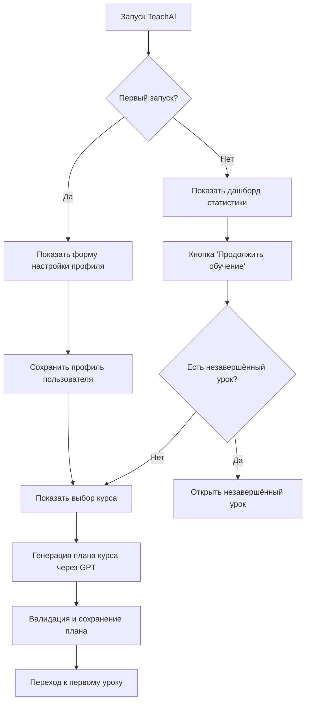
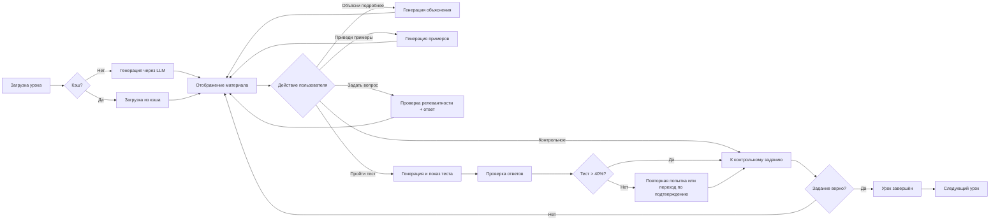

# TeachAI — Интеллектуальная система персонализированного обучения

Документ составлен **по анализу исходного кода** репозитория. Устаревшие описания не используются как источник фактов. Описание опирается на анализ исходного кода; при актуализации проверены затронутые утверждения, сплошная повторная сверка всех разделов не проводилась.

---

## 📋 Содержание

1. [Общее описание проекта](#общее-описание-проекта)
2. [Назначение и цели](#назначение-и-цели)
3. [Ключевые идеи и концепции](#ключевые-идеи-и-концепции)
4. [Архитектура системы](#архитектура-системы)
5. [Логика работы системы](#логика-работы-системы)
6. [Модульная структура проекта](#модульная-структура-проекта)
7. [Использование GPT-модели](#использование-gpt-модели)
8. [Управление состоянием и данными](#управление-состоянием-и-данными)
9. [Интерактивный интерфейс](#интерактивный-интерфейс)
10. [Технологический стек](#технологический-стек)
11. [Особенности реализации](#особенности-реализации)
12. [Вопрос дообучения модели](#вопрос-дообучения-модели)
13. [Примеры использования](#примеры-использования)

---

## Общее описание проекта

**TeachAI** — это интеллектуальная образовательная платформа, работающая в среде Jupyter Notebook и использующая API OpenAI GPT для автоматической генерации персонализированных учебных материалов. 

Система способна:
- 📚 Создавать полноценные учебные планы под заданные параметры обучения
- 📖 Генерировать детальные уроки с теорией, примерами и кодом
- 🧪 Создавать тесты для проверки усвоения материала
- ❓ Отвечать на вопросы студентов по содержанию урока
- 📊 Отслеживать прогресс обучения и статистику
- 🎯 Адаптировать стиль общения под предпочтения пользователя

---

## Назначение и цели

### Основная цель

Создать **интерактивного AI-учителя Python и AI/ML** в **Jupyter Notebook**: персонализированный маршрут, генерация материалов и проверка усвоения без отдельного веб-сервера и без собственной обучаемой модели. Каталог курсов — Python, анализ данных и машинное обучение. Своё название курса модель относит к этой области или нет: вне области курс не стартует сам, его можно начать после предупреждения (`course_domain_ui.gate_custom_course`). Если проверку темы выполнить не удалось, курс не запускается. Исполняемая практика идёт в дочернем процессе Python (`code_sandbox.run_student_code`), не в ядре notebook.

Цель следует из назначения модулей:

- `engine.py` — «координация всех компонентов системы» TeachAI;
- `lesson_generator.py` — генерация «структурированных образовательных материалов»;
- `content_generator.py` — фасад генерации «уроков, вопросов и обработки ответов пользователя» через OpenAI;
- `interface.py` — «взаимодействие с пользователем через Jupyter Notebook».

### Задачи проекта (реализованные в коде)

| Задача | Реализация |
|--------|------------|
| Профиль обучающегося | `SetupInterface`, `UserProfileManager` — имя, часы обучения, длительность урока, стиль общения |
| Выбор курса из каталога или своё название | `courses.json`, `custom_course.py`, `course_selection_ui.py` |
| Портфель нескольких курсов | `course_portfolio.py` — слоты в `state["courses"]`, зеркало активного в корне |
| Построение учебного плана под время пользователя | `CoursePlanGenerator.generate_course_plan()` → сохранение в `state["course_plan"]` |
| Генерация содержания урока | `LessonGenerator` + `ContentFormatterFinal` |
| Интерактив на уроке: вопросы, примеры, объяснения, понятия | `LessonInteraction`, `QAGenerator`, `ExamplesGenerator`, `ExplanationGenerator`, `ConceptsGenerator` |
| Вопрос: материал урока, предмет курса или вне курса | `RelevanceChecker`: `lesson` / `course` / `outside` |
| Тестирование после урока | `Assessment`, `AssessmentGenerator`, `AssessmentInterface` |
| Практика с проверкой кода | `ControlTasksGenerator`, `ControlTasksInterface`, `InteractiveCellWidget`, `ResultChecker` |
| Учёт прогресса и возврат к незавершённому уроку | `LearningProgressManager`, `StartupDashboard`, `CourseDataManager.get_next_lesson()` |
| Логирование действий | `Logger` → `logs/` |
| Локальное хранение состояния | `StateManager` → `data/state.json` |

Задачи, **не** реализованные в текущем коде (для ясности границ проекта):

- дообучение / fine-tuning модели;
- централизованный сервер приложений (только клиент в notebook + API OpenAI);
- парсинг внешних учебников как основной источник контента (контент генерируется LLM по метаданным курса и плану).

### Целевая аудитория

- Студенты, изучающие программирование самостоятельно
- Преподаватели, нуждающиеся в инструменте для быстрой подготовки материалов
- Образовательные платформы, желающие автоматизировать создание контента

---

## Ключевые идеи и концепции

### 1. Промпт-инженерия вместо дообучения

**Центральная идея:** использование готовой GPT-модели через тщательно разработанные промпты вместо fine-tuning.

**Преимущества подхода:**
- ⚡ Быстрое развёртывание без необходимости обучения модели
- 🔄 Возможность адаптации под темы из области Python/AI/ML
- 💰 Экономия ресурсов (нет затрат на GPU и датасеты)
- 📈 Обновления базовой модели OpenAI могут улучшать результаты

### 2. Фасадная архитектура

**Принцип:** разделение ответственности через специализированные модули-генераторы.

```
ContentGenerator (фасад)
    ├── CoursePlanGenerator    → планы курсов
    ├── LessonGenerator         → содержание уроков
    ├── ExamplesGenerator       → практические примеры
    ├── AssessmentGenerator     → тесты и вопросы
    ├── QAGenerator             → ответы на вопросы
    ├── ConceptsGenerator       → ключевые понятия
    ├── ControlTasksGenerator   → контрольные задания
    └── RelevanceChecker        → проверка релевантности
```

### 3. Многоуровневая валидация

**Концепция:** для разных типов генерируемого контента применяются различные проверки. Набор валидаций зависит от конкретного генератора.

1. **Структурная валидация**: проверка JSON-схем, наличия обязательных полей (для планов курсов, тестов)
2. **Семантическая валидация**: проверка релевантности содержания теме (для вопросов, ответов)
3. **Формат-валидация**: проверка корректности кода, markdown-разметки (для уроков, примеров)
4. **Автокоррекция**: исправление типичных ошибок и перегенерация при необходимости (для планов курсов)

### 4. Сохранение состояния

**Идея:** персистентное хранение прогресса обучения в локальном JSON-файле.

Хранится:
- Профиль пользователя (имя, стиль общения, параметры обучения)
- Текущий прогресс (текущий урок, завершённые уроки)
- Результаты тестов (оценки, попытки, статистика)
- План курса (структура разделов, тем и уроков)
- Кэш уроков (`lesson_content_cache`)

---

## Архитектура системы

### Архитектурная схема

```
┌─────────────────────────────────────────────────────────────┐
│                    TeachAI Engine (Оркестратор)              │
│  - Инициализация компонентов                                 │
│  - Координация потока работы                                 │
│  - Управление жизненным циклом                               │
└─────────────┬───────────────────────────────────────────────┘
              │
      ┌───────┴────────┬──────────────┬─────────────┬──────────┐
      │                │              │             │          │
┌─────▼─────┐  ┌──────▼──────┐  ┌───▼────┐  ┌─────▼────┐  ┌─▼────────┐
│  Config   │  │    State    │  │Content │  │Interface │  │Assessment│
│  Manager  │  │   Manager   │  │Generator│  │          │  │          │
└───────────┘  └──────┬──────┘  └────────┘  └──────────┘  └──────────┘
                      │
          ┌───────────┼───────────┐
          │           │           │
    ┌─────▼─────┐ ┌──▼──────┐ ┌─▼────────┐
    │  User     │ │Learning │ │  Course  │
    │  Profile  │ │Progress │ │   Data   │
    └───────────┘ └─────────┘ └──────────┘
```

### Ключевые компоненты

| Компонент | Файл | Назначение |
|-----------|------|------------|
| **TeachAIEngine** | `engine.py` | Главный оркестратор системы: init, start, shutdown, проверка урока |
| **ConfigManager** | `config.py` | Управление конфигурацией `.env`, каталоги `logs/` и `data/`; маршрут делегирует в `llm_route.py` |
| **LLM Route** | `llm_route.py` | Маршрут `direct` / `gptunnel` / `proxy`, ключ активного маршрута, клиент |
| **StateManager** | `state_manager.py` | Фасад над профилем, прогрессом, планом курса, кэшем уроков |
| **ContentGenerator** | `content_generator.py` | Фасад над 8+ генераторами |
| **UserInterface** | `interface.py` | Фасад интерактивного UI, маршрутизация экранов |
| **Assessment** | `assessment.py` | Оценивание знаний, проверка ответов, связь с логгером |
| **StartupDashboard** | `startup_dashboard.py` | Статистика при повторном запуске |
| **Logger** | `logger.py` | История уроков, вопросов, тестов, активности |

### Специализация StateManager

`StateManager` делегирует:

- **UserProfileManager** — `state["user"]`
- **LearningProgressManager** — `state["learning"]`, завершённость уроков, оценки, счётчик вопросов
- **CourseDataManager** — `state["course_plan"]`, чтение `courses.json`, навигация `get_next_lesson()`

Дополнительные секции в `state.json` (создаются по мере работы):

- `lesson_content_cache` — HTML и `raw_content` уроков
- `control_tasks` — результаты контрольных заданий
- `courses` — портфель нескольких курсов (`course_portfolio.py`)
- `system` — `first_run`, `last_access`, `version` (по умолчанию `"1.0.0"`)

### Специализация UserInterface

Состояния интерфейса (`InterfaceState` в `interface_utils.py`):

`INITIAL_SETUP` → `COURSE_SELECTION` → `LESSON_VIEW` → (`ASSESSMENT` | `QUESTION_ANSWER` | …) → `COURSE_COMPLETION`

Реализации экранов:

- `SetupInterface` — профиль и выбор курса + вызов генерации плана
- `LessonInterface` — урок (делегаты: `LessonDisplay`, `LessonNavigation`, `LessonInteraction`)
- `AssessmentInterface` — тест
- `CompletionInterface` — завершение курса

### Специализация ContentGenerator

| Генератор | Назначение |
|-----------|------------|
| `CoursePlanGenerator` | JSON-план: sections → topics → lessons |
| `LessonGenerator` | Текст урока (markdown) → HTML |
| `ExamplesGenerator` | Практические примеры (данные + HTML) |
| `ExplanationGenerator` | Расширенное объяснение |
| `ConceptsGenerator` | Ключевые понятия и объяснение понятия |
| `QAGenerator` | Ответ на вопрос по уроку |
| `AssessmentGenerator` | Вопросы теста |
| `ControlTasksGenerator` | Контрольные задания с проверкой кода |
| `RelevanceChecker` | Уровни `lesson` / `course` / `outside`; `reason` уровень не меняет |

Общая база: **`BaseContentGenerator`** в `llm_api_base.py` — клиент выбранного маршрута, retry, очистка HTML урока для промптов, отладочные дампы в `debug_responses/`. `content_utils.py` эти имена только реэкспортирует.

---

## Логика работы системы

### Сценарий первого запуска



### Жизненный цикл урока

**Примечание:** диаграмма показывает один из типичных сценариев. Реальная логика допускает:
- переход к контрольному заданию без прохождения теста (с подтверждением);
- принудительное завершение урока вручную;
- генерацию урока из кэша (минуя повторную генерацию через LLM).



### Pipeline AI-учителя: от запуска до ответа

#### 1. Запуск системы и выбор маршрута API

1. **Ячейка настройки в TeachAI.ipynb**: `API_ROUTE = None` либо ровно `direct`, `gptunnel` или `proxy`. Это выбор **до** запуска учебного интерфейса, не виджет на дашборде. Другие написания ячейка не принимает.

2. **Ячейка Start**: `start_jupyter(api_route=API_ROUTE)` снимает явный маршрут прошлого запуска, затем `load_dotenv(override=True)`.

3. **Цепочка выбора маршрута** (`llm_route.py`):
   - `None` маршрут сам не назначает
   - **Если `OPENAI_API_ROUTE` НЕпустое:**
     - узнаваемое значение (`direct`, `gptunnel`, `proxy`) → применяется
     - неузнаваемое → пропускает preference, идёт в совместимые переменные, затем `direct`
   - **Если `OPENAI_API_ROUTE` пустое:**
     - файл `data/llm_route_preference.json` (если есть)
     - иначе совместимые `OPENAI_USE_PROXY` и `OPENAI_CONNECTION_MODE`
     - иначе `direct`

4. **Явные `direct`, `gptunnel`, `proxy`** в ячейке ставятся после загрузки `.env` и побеждают цепочку выше. В `.env` и в preference они не пишутся.

5. **Требования по маршрутам**:
   - `direct` — `OPENAI_API_KEY`
   - `gptunnel` — `GPTUNNEL_API_KEY` и `GPTUNNEL_BASE_URL` (иначе `https://gptunnel.ru/v1`)
   - `proxy` — `OPENAI_API_KEY` и URL в `OPENAI_PROXY` / `HTTPS_PROXY` / `HTTP_PROXY`

6. **Инициализация `TeachAIEngine()`**:
   - **Повторный запуск**: проверка `.env` и `StateManager`, показ `StartupDashboard`. `ContentGenerator` и клиент создаются по «Продолжить обучение».
   - **Первый запуск**: `initialize()` создаёт генераторы и клиент до `UserInterface.show_initial_setup()`.

#### 2. Первичная настройка и план курса

1. `SetupInterface.show_initial_setup()` — форма: имя, часы обучения (1–100), длительность урока (5–120 мин), стиль (`formal` | `friendly` | `casual` | `brief`).
2. Сохранение в `state["user"]`, `reset_learning_and_course_data()`, `first_run = false`.
3. `show_course_selection()` — каталог `courses.json` **или** своё название. При подтверждении **нового** курса проверяется принадлежность к Python/AI/ML (`course_domain.py`): вне области — предупреждение и опция принудительного старта; ошибка проверки — блокировка старта. Если курс уже есть в портфеле — продолжение без повторной генерации плана.
4. `ContentGenerator.generate_course_plan(course_data, total_study_hours, lesson_duration_minutes)`:
   - промпт методиста → OpenAI с `response_format: json_object`;
   - валидация/нормализация `_validate_and_fix_course_plan`;
   - `save_course_plan()` в state.

#### 3. Показ урока

Цепочка в `LessonDisplay.show_lesson(section_id, topic_id, lesson_id)`:

1. Ключ кэша: `"{section_id}:{topic_id}:{lesson_id}"`.
2. Загрузка метаданных урока из `course_plan`.
3. **Кэш** (в порядке приоритета):
   - `state["lesson_content_cache"]` (постоянный);
   - in-memory кэш `LessonInterface`;
   - иначе **`LessonGenerator.generate_lesson(...)`**:
     - system: преподаватель, Markdown, код в ```lang языка темы;
     - user: промпт с курсом/разделом/темой/уроком и стилем;
     - `make_api_request(temperature=0.7, max_tokens=3500)`;
     - `ContentFormatterFinal.format_lesson_content()` → HTML;
     - сохранение `content` + `raw_content` (сырой ответ LLM до CSS).
4. `update_learning_progress()`, `Logger.log_lesson()`.
5. Сборка виджетов: HTML через `student_content.render_student_content()`, кнопки, навигация.

**Примечание:** автоматическая вставка интерактивных ячеек через `cell_integration` в `lesson_display.py` **отключена** (`CELLS_INTEGRATION_AVAILABLE = False`).

#### 4. Вопрос пользователя (Q&A)

Обработчик кнопки в `LessonInteraction.setup_enhanced_qa_container`. Счётчик до проверки не увеличивается. Локальных эвристик по корням слов нет: решение принимает модель.

1. **`check_question_relevance(...)`** готовит текст урока: срез шапки «курс / раздел / тема», очистка HTML, лимит символов. **Название курса и описание плана передаются отдельным блоком**. Название темы за название курса не подставляется.

2. **Ожидаемый JSON**: `scope` (`lesson` | `course` | `outside`), `is_relevant`, `confidence`, `reason`, `suggestions`. **Узнаваемый `scope` важнее противоречащего `is_relevant`**. Слова в `reason` уровень не меняют.

3. **Три уровня обработки**:
   - `outside`: отказ «Вопрос вне курса», `increment_offtopic_count`. Ответ по теме не генерируется.
   - `lesson`: обычный ответ `QAGenerator.answer_question`, затем `increment_questions_count`.
   - `course`: тот же ответ и жёлтая пометка, что это не тема урока, но вопрос по курсу; счётчик вопросов тот же.

4. **Некорректный ответ классификатора** — три разные ветки:
   - Текст, из которого `parse_llm_json` не достаёт JSON: `check_question_relevance` бросает «Не удалось проверить релевантность вопроса». Кнопка показывает «Ошибка при генерации ответа», счётчики не растут.
   - Разобранный объект без узнаваемого `scope`: уровень берётся из `is_relevant`. Поля нет, значение уже `false`, либо строка не из `'true'` / `'1'` / `'yes'` / `'да'` — уровень `outside` и отказ. Истина (`true` или такая строка) — `lesson`.
   - Разобранное значение без полей объекта (список, число, `null`): исключение в `_extract_relevance_from_response`, запасной результат `scope=lesson`.

#### 5. Тест (assessment)

1. `Assessment.generate_questions` → `AssessmentGenerator` (контент урока, ~4000 символов очищенного текста).
2. `Assessment.check_answer` сравнивает индекс варианта.
3. **Прохождение теста: score > 40%** (`assessment_results_handler.py`).
4. `save_lesson_assessment`, `Logger.log_assessment`.

**Тест сам по себе не завершает урок**.

#### 6. Контрольное задание

1. `ControlTasksGenerator` генерирует задачу (описание, стартовый код, эталон, тип проверки).
2. Выполнение вызывает `code_sandbox.run_student_code` — **дочерний процесс**: `stdin` закрыт, каталог временный и затем удаляется, окружение — allowlist. Внутри процесса работника код выполняется через `exec`; ядро notebook этот `exec` не вызывает. Сравнение результата — `ResultChecker`.
3. Вывод stdout экранируется (`format_execution_stdout_html`).
4. **Это ограничение процесса, не защита от произвольного кода.**
5. Успех → `StateManager.save_control_task_result(lesson_id, ..., is_correct=True)`.

#### 7. Завершение урока

`LearningProgressManager.is_lesson_completed(lesson_id)`:

- `True`, если урок отмечен принудительно (`lesson_completion_status`), **или** контрольное задание выполнено верно (`control_tasks.is_correct`) **и выполнено хотя бы одно условие:** тест **> 40%** или подтверждён переход к контрольному без теста (`control_task_bypass`).
- Подтверждённый обход теста сам урок не завершает и контрольное не отменяет.
- После прохождения всех уроков — `CompletionInterface.show_course_completion()`.

---

## Модульная структура проекта

### 1. Ядро системы (Core)

| Модуль | Описание |
|--------|----------|
| `engine.py` | Главный класс TeachAIEngine, инициализация и координация, логи в `logs/teachai.log` |
| `run_teachai.py` | Единая точка входа, порядок reload модулей, аргумент `api_route` |
| `config.py` | Управление конфигурацией (`.env`, API ключи, каталоги); выбор маршрута делегирует в `llm_route.py` |
| `llm_route.py` | Приоритет маршрута, клиент, проверка ключа и прокси только для выбранного маршрута |
| `logger.py` | Логирование действий системы: `activity_log.json`, `questions_log.json`, `assessment_log.json`, `lesson_history.md` |

### 2. Управление состоянием (State Management)

| Модуль | Описание |
|--------|----------|
| `state_manager.py` | Базовый менеджер состояния (координатор) |
| `user_profile_manager.py` | Управление профилем пользователя |
| `learning_progress_manager.py` | Отслеживание прогресса обучения |
| `course_data_manager.py` | Управление данными курсов, навигация `get_next_lesson()` |

### 3. Генерация контента (Content Generation)

| Модуль | Описание |
|--------|----------|
| `content_generator.py` | **Фасад** для всех генераторов контента |
| `llm_api_base.py` | `BaseContentGenerator`, `make_api_request`, retry логика |
| `content_utils.py` | Фасад совместимости: реэкспорт в `llm_json`, `llm_api_base`, `communication_style` и клиент из `llm_route` |
| `course_plan_generator.py` | Генерация планов курсов |
| `lesson_generator.py` | Генерация содержания уроков |
| `examples_generator.py` | Генерация практических примеров |
| `explanation_generator.py` | Детальные объяснения материала |
| `assessment_generator.py` | Генерация тестов и вопросов |
| `qa_generator.py` | Ответы на вопросы студентов |
| `concepts_generator.py` | Извлечение ключевых понятий |
| `relevance_checker.py` | Проверка релевантности вопросов (`lesson` / `course` / `outside`) |
| `control_tasks_generator.py` | Генерация контрольных заданий |

### 4. Пользовательский интерфейс (User Interface)

| Модуль | Описание |
|--------|----------|
| `interface.py` | **Фасад** интерфейса |
| `interface_utils.py` | Утилиты для создания UI-элементов |
| `setup_interface.py` | Настройка профиля и выбор курса |
| `lesson_interface.py` | Отображение уроков |
| `lesson_display.py` | Визуализация содержания урока |
| `lesson_navigation.py` | Навигация между уроками |
| `lesson_interaction.py` | Интерактивные функции (объяснения, примеры, Q&A) |
| `lesson_utils.py` | Утилиты для работы с уроками |
| `lesson_outline.py` | Карта уроков с переходами |
| `assessment_interface.py` | Интерфейс тестирования |
| `assessment_results_handler.py` | Обработка результатов тестов |
| `completion_interface.py` | Экран завершения курса |
| `startup_dashboard.py` | Дашборд статистики при запуске |
| `loading_indicators.py` | Индикаторы загрузки при долгих запросах к API |

### 5. Оценивание и практика (Assessment & Practice)

| Модуль | Описание |
|--------|----------|
| `assessment.py` | Проверка ответов и расчёт оценок |
| `control_tasks_interface.py` | Интерфейс контрольных заданий |
| `result_checker.py` | Проверка правильности решений (exact, numeric, list, function, output и др.) |
| `code_sandbox.py` | Дочерний процесс для примеров, контрольных и интерактивных ячеек |
| `interactive_cell_widget.py` | Виджет редактора кода |
| `interactive_cell_logic.py` | Логика выполнения кода через `run_student_code` |
| `interactive_cell_ui.py` | UI интерактивной ячейки |
| `cell_widget_base.py` | Базовый класс для cell-виджетов |

### 6. Форматирование и валидация

| Модуль | Описание |
|--------|----------|
| `content_formatter_final.py` | Финальное форматирование контента: fences → `<pre>`, остальное через канон |
| `content_renderer.py` | Таблицы, LaTeX→MathML, `enhance_content`, `render_markdown_to_html` |
| `student_content.py` | Канон показа: Markdown/HTML → HTML для ipywidgets |
| `examples_validation.py` | Валидация практических примеров |
| `examples_code_fixes.py` | Санитизация кода примеров |
| `examples_display.py` | Отображение примеров |

### 7. Курсы и портфель

| Модуль | Описание |
|--------|----------|
| `courses.json` | Статический каталог (5 курсов) |
| `custom_course.py` | Логика своего курса |
| `course_selection_ui.py` | UI выбора курса |
| `course_domain.py` | Проверка принадлежности темы к Python/AI/ML |
| `course_domain_ui.py` | UI подтверждения старта вне области (`gate_custom_course`) |
| `project_identity.py` | Название и рамка предметной области на первом экране |
| `course_portfolio.py` | Несколько курсов в `state.json` (старт нового без wipe, переключение, удаление) |
| `course_portfolio_ui.py` | UI портфеля курсов |

---

## Использование GPT-модели

---

**⚠️ О примерах кода в этом документе:**

Все приведённые ниже фрагменты кода являются **упрощёнными иллюстрациями** и **концептуальными схемами**, демонстрирующими логику и паттерны работы системы. Они не предназначены для буквального копирования и запуска. Имена функций могут быть условными обозначениями. Для точных команд запуска и актуальной реализации обращайтесь к исходному коду репозитория и файлу `run_teachai.py`.

---

### Подход к использованию API

```python
# Концептуальный пример паттерна работы с OpenAI API

class BaseContentGenerator:
    def __init__(self, api_key):
        # Клиент создаётся через llm_route
        self.client = get_client_from_route()  # концептуально: llm_route.get_openai_client()
    
    def make_api_request(self, messages, temperature=0.7, 
                         max_tokens=3500, response_format=None):
        """Единообразный вызов OpenAI API"""
        response = self.client.chat.completions.create(
            model=get_model_from_env(),  # концептуально: config.LLM_MODEL или 'gpt-4o-mini'
            messages=messages,
            temperature=temperature,
            max_tokens=max_tokens,
            response_format=response_format
        )
        return response.choices[0].message.content
```

### Типы промптов

#### 1. Системные промпты

Определяют роль и поведение модели:

```python
{
    "role": "system",
    "content": "Ты - опытный преподаватель Python. Создавай подробные уроки БЕЗ финальных прощаний."
}
```

#### 2. Пользовательские промпты

Содержат конкретную задачу с детальными инструкциями:

```python
prompt = f"""
🚨 КРИТИЧЕСКАЯ ИНСТРУКЦИЯ ДЛЯ API! 🚨

Создай образовательный урок по теме:
Курс: {course}
Тема: {topic}

ВАЖНЫЕ ТРЕБОВАНИЯ:
1. ВСЕ примеры кода должны быть на Python
2. Код должен быть правильно отформатирован
3. Каждая строка кода на отдельной строке
4. Используй markdown-блоки: ```python ... ```

Урок должен содержать:
- Введение в тему
- Основные концепции
- Практические примеры
- Краткое заключение
"""
```

### Стратегии повышения качества

#### 1. Эмоджи-маркеры в промптах

```python
# Привлечение внимания модели к критическим требованиям
"""
🚨 КРИТИЧЕСКИ ВАЖНО! 🚨
⚠️ ОБЯЗАТЕЛЬНОЕ ТРЕБОВАНИЕ! ⚠️
"""
```

#### 2. Многократное повторение требований

```python
"""
ЭТО КУРС ПО PYTHON! ВСЕ ПРИМЕРЫ КОДА ДОЛЖНЫ БЫТЬ НА PYTHON!
...
🚨 ЭТО КУРС ПО PYTHON! 🚨
...
ОБЯЗАТЕЛЬНО ИСПОЛЬЗУЙ PYTHON!
"""
```

#### 3. Примеры правильного и неправильного форматирования

````python
"""
ПРАВИЛЬНО:
```python
count = 0
while count < 5:
    print(count)
    count += 1
```

НЕПРАВИЛЬНО (НЕ ДЕЛАЙ ТАК!):
```python
count = 0 while count < 5: print(count) count += 1
```
"""
````

#### 4. Указание формата ответа

```python
response = self.make_api_request(
    messages=messages,
    response_format={"type": "json_object"}  # Требование JSON
)
```

### Обработка ответов

```python
def process_gpt_response(response_content, content_type):
    # 1. Парсинг (если JSON)
    if content_type == "course_plan":
        data = json.loads(response_content)
    
    # 2. Валидация структуры
    if not validate_structure(data):
        raise ValidationError("Некорректная структура")
    
    # 3. Очистка от markdown-меток
    cleaned = clean_markdown_code_blocks(data)
    
    # 4. Форматирование
    formatted = format_content(cleaned)
    
    return formatted
```

---

## Управление состоянием и данными

### Структура файла состояния (`data/state.json`)

**Примечание:** представлена **схема структуры** (не валидный JSON для копирования). Многоточия `[...]` и `{...}` обозначают сокращённые секции. Реальный файл содержит полные значения.

```json
{
  "user": {
    "name": "Иван",
    "total_study_hours": 20,
    "lesson_duration_minutes": 30,
    "communication_style": "friendly"
  },
  "learning": {
    "current_course": "python-basics",
    "current_section": "section-1",
    "current_topic": "topic-1",
    "current_lesson": "lesson-1",
    "completed_lessons": ["section-1:topic-1:lesson-1"],
    "lesson_scores": {
      "section-1:topic-1:lesson-1": 85.0
    },
    "lesson_attempts": {
      "section-1:topic-1:lesson-1": [
        {"score": 70, "timestamp": "2026-01-20T15:30:00", "is_passed": false},
        {"score": 85, "timestamp": "2026-01-20T16:00:00", "is_passed": true}
      ]
    },
    "lesson_completion_status": {
      "section-1:topic-1:lesson-1": true
    },
    "average_score": 85.0,
    "course_progress_percent": 33.3
  },
  "course_plan": {
    "id": "python-basics",
    "title": "Основы Python",
    "sections": [
      {
        "id": "section-1",
        "title": "Введение в Python",
        "topics": "<сокращено>"
      }
    ]
  },
  "lesson_content_cache": {
    "section-1:topic-1:lesson-1": {
      "content": "<HTML-контент>",
      "raw_content": "Markdown текст урока..."
    }
  },
  "control_tasks": {
    "section-1:topic-1:lesson-1": {
      "task_title": "Создание списка",
      "is_correct": true,
      "completed_at": "2026-01-20T16:15:00"
    }
  },
  "courses": {
    "slot_1": "<данные курса 1>",
    "slot_2": "<данные курса 2>"
  },
  "system": {
    "first_run": false,
    "last_access": "2026-01-31T10:00:00",
    "version": "1.0.0"
  }
}
```

### Специализированные менеджеры

#### UserProfileManager

```python
class UserProfileManager:
    def update_user_profile(self, name, hours, duration, style):
        """Обновление профиля пользователя"""
        
    def get_communication_style(self):
        """Получение стиля общения"""
        
    def validate_user_profile(self):
        """Проверка корректности профиля"""
```

#### LearningProgressManager

```python
class LearningProgressManager:
    def save_lesson_assessment(self, lesson_id, score, is_passed):
        """Сохранение результата теста"""
        
    def is_lesson_completed(self, lesson_id):
        """Проверка завершённости урока"""
        # Урок считается завершённым если:
        # 1. Отмечен принудительно ИЛИ
        # 2. Контрольное задание выполнено верно И
        #    (Тест > 40% ИЛИ Подтверждён переход к контрольному без теста)
        
    def mark_lesson_complete_manually(self, lesson_id):
        """Принудительное завершение урока"""
```

#### CourseDataManager

```python
class CourseDataManager:
    def save_course_plan(self, course_plan):
        """Сохранение плана курса"""
        
    def get_next_lesson(self):
        """Определение следующего урока"""
        # Логика:
        # - Если текущий урок не завершён → вернуть его
        # - Иначе найти следующий урок в плане
        
    def get_lesson_data(self, section_id, topic_id, lesson_id):
        """Получение данных урока из плана"""
```

---

## Интерактивный интерфейс

### Компоненты интерфейса на ipywidgets

#### 1. Форма настройки профиля

```python
name_widget = widgets.Text(
    description="Имя:",
    placeholder="Введите ваше имя"
)

communication_style_widget = widgets.Dropdown(
    options=[
        ("Формальный", "formal"),
        ("Дружелюбный", "friendly"),
        ("Непринужденный", "casual"),
        ("Краткий", "brief")
    ],
    value="friendly"
)
```

#### 2. Дашборд статистики

```python
def show_dashboard(self):
    """Отображает статистику обучения"""
    
    # Данные для дашборда
    dashboard_data = {
        "progress_stats": {
            "completed_lessons": 5,
            "total_lessons": 15,
            "progress_percent": 33.3
        },
        "assessment_stats": {
            "average_score": 82.5,
            "passed_tests": 4,
            "total_tests": 5
        },
        "time_stats": {
            "days_since_last_access": 2
        }
    }
    
    # Создание виджетов
    progress_bar = widgets.IntProgress(
        value=33,
        min=0,
        max=100,
        description='Прогресс:'
    )
    
    stats_html = widgets.HTML(value=f"""
        <div>
            <h3>📊 Статистика обучения</h3>
            <p>Средняя оценка: {average_score}%</p>
            <p>Завершено уроков: {completed}/{total}</p>
        </div>
    """)
```

#### 3. Интерфейс урока

```python
# Кнопки навигации
test_button = widgets.Button(
    description="Пройти тест",
    button_style="success",
    icon="check"
)

explain_button = widgets.Button(
    description="Объясни подробнее",
    button_style="info",
    icon="book"
)

# Контейнеры для интерактивных функций
qa_container = widgets.VBox(
    layout=widgets.Layout(display='none')  # Скрыт по умолчанию
)

# Обработчик кнопки
def on_test_button_clicked(b):
    clear_output(wait=True)
    test_widget = self.show_assessment()
    display(test_widget)

test_button.on_click(on_test_button_clicked)
```

### Индикаторы загрузки

```python
class LoadingManager:
    def show_loading(self, loading_type, **kwargs):
        """Показывает индикатор загрузки"""
        
        if loading_type == "openai":
            return widgets.HTML(value="""
                <div style='text-align: center; padding: 20px;'>
                    <div class='spinner'></div>
                    <p>Генерация контента через OpenAI API...</p>
                </div>
            """)
```

---

## Технологический стек

### Язык и среда выполнения

- **Python 3** — нижняя граница версии в `requirements.txt` не задана
- **Jupyter Notebook** (`TeachAI.ipynb`, зависимости `jupyter`, `ipykernel`, `ipython`)
- **IPython.display** и **ipywidgets** — UI в notebook
- Имена `venv_H_L` и `venv_W_L` — примеры уже существующих окружений, не требование установки

### Искусственный интеллект

- Клиент — пакет **`openai`** (`openai>=1.95.1`), вызов `client.chat.completions.create` (`BaseContentGenerator.make_api_request` в `llm_api_base.py`). Отдельного SDK шлюза нет.
- Модель чата по умолчанию: **`gpt-4o-mini`**, если не задана `LLM_MODEL` (`llm_api_base.BaseContentGenerator`).
- Для части валидации контрольных заданий: **`VALIDATION_MODEL`**; если её нет — `LLM_MODEL`, иначе снова `gpt-4o-mini` (`control_tasks_generator.ControlTasksGenerator.__init__`).
- Маршрут задаётся до учебного UI (`llm_route.py`): `direct`, `gptunnel` или `proxy`. Прокси приложения нужен только для `proxy`. `gptunnel` значением по умолчанию не является: без источников маршрута код выбирает `direct`. Шлюз использует `GPTUNNEL_API_KEY` и `base_url` (`GPTUNNEL_BASE_URL` или `https://gptunnel.ru/v1`); имя модели при этом не меняется.

### Конфигурация и данные

- **python-dotenv** — `.env`. Если своего файла ещё нет: `test -f .env || cp .env.sample .env`. Существующий `.env` эта команда не перезаписывает.
- **JSON** — `courses.json`, `data/state.json`, логи в `logs/*.json`, сохранённый маршрут `data/llm_route_preference.json`

### Отображение контента

- **markdown**, **pygments** — разметка и подсветка
- **latex2mathml** — формулы в HTML для виджетов (`content_renderer.py`)
- Собственные модули: `content_formatter_final.py`, `content_renderer.py`, `student_content.py`

### Предметные библиотеки (для примеров и контрольных заданий)

По `requirements.txt`, сгруппировано по курсам:

- Анализ данных: pandas, numpy, matplotlib, seaborn, scipy, openpyxl
- ML: scikit-learn, tensorflow
- Веб: flask, requests
- Финансы: yfinance

Они не требуются для импорта `engine.py`, но нужны, когда код ученика в дочернем процессе их импортирует.

### Инфраструктура разработки

- `.pre-commit-config.yaml` — хуки качества (в runtime обучения не участвует)
- `pytest.ini`: обычный прогон `python -m pytest -q` добавляет `-m "not live"`. Маркер `live` — запрос к настоящей модели, по умолчанию выключен. Перед полным прогоном TeachAI и его ядро нужно остановить: фикстура `real_data_untouched` в `tests/conftest.py` сверяет время и размер `data/state.json`.
- Каталог `archive/` — старые notebook и презентации, **не** подключаются `run_teachai.py`

---

## Особенности реализации

Формулировки опираются на **конкретные решения в коде**, а не на маркетинговые обещания.

### 1. Модульная архитектура с фасадами

`ContentGenerator` и `UserInterface` сохраняют обратную совместимость API при выносе логики в отдельные файлы (комментарии в `content_generator.py`, `interface.py`).

### 2. Двухуровневое кэширование уроков

Память сессии + `lesson_content_cache` в `state.json` снижает число дорогих вызовов OpenAI при повторном открытии урока (`lesson_display.py`, `state_manager.py`).

### 3. Разделение `content` и `raw_content`

Форматированный HTML для показа, сырой markdown для LLM-анализа (релевантность, понятия), без утечки CSS в промпты (`lesson_generator.py`, `prepare_lesson_text_for_analysis`).

### 4. Три уровня вопроса с передачей контекста курса

`lesson`, `course` и `outside`. Шапка урока снимается, предмет курса передаётся отдельно. `reason` уровень не переписывает. Это решение модели, не измеренная точность классификатора (`relevance_checker.py`).

### 5. Комбинированная проверка усвоения

Урок завершён принудительно **или** контрольное верно **и выполнено хотя бы одно условие:** тест > 40% или подтверждённый переход к контрольному без теста. Вход в контрольное без теста (`lesson_control_access.py`) сам урок не закрывает (`learning_progress_manager.is_lesson_completed`).

### 6. Персонализация

Стиль общения в промптах всех генераторов (`ContentUtils.COMMUNICATION_STYLES`), имя пользователя в уроке, план под заданные часы и длительность занятия.

### 7. Устойчивость сети

`make_api_request_with_retries` с экспоненциальной задержкой (`llm_api_base.py`).

### 8. Наблюдаемость

Структурированные логи: `activity_log.json`, `questions_log.json`, `assessment_log.json`, `lesson_history.md` (`logger.py`).

### 9. Ленивый старт

При повторном запуске сначала показывается дашборд, а тяжёлая инициализация выполняется по кнопке продолжения обучения (`engine.py`, `startup_dashboard.py`).

### 10. Отображение учебного контента в Jupyter

Конвертация LaTeX и markdown-таблиц для `widgets.HTML`, где MathJax недоступен (`content_renderer.py`).

### 11. Воспроизводимость ML-практики

Фиксация `random_state` в типовых вызовах sklearn при проверке (`control_tasks_generator.py`).

### 12. Валидация и автокоррекция планов курсов

```python
# course_plan_generator.py
def _validate_and_fix_course_plan(self, course_plan, ...):
    """Валидирует и исправляет структуру плана курса"""
    
    # Проверка обязательных ключей
    if "id" not in course_plan:
        course_plan["id"] = course_data.get("id", "course-1")
    
    # Проверка разделов
    if "sections" not in course_plan:
        course_plan["sections"] = self._create_minimal_sections(...)
    
    # Проверка каждого раздела
    for section in course_plan["sections"]:
        if "topics" not in section:
            section["topics"] = self._create_minimal_topics(...)
        
        # Проверка каждой темы
        for topic in section["topics"]:
            if "lessons" not in topic:
                topic["lessons"] = self._create_minimal_lessons(...)
    
    return course_plan
```

### 13. Принудительная рандомизация вариантов ответов в тестах

```python
# assessment_generator.py
def _force_randomize_questions(self, questions):
    """Перемешивает варианты ответов (API не всегда следует инструкциям)"""
    
    randomized_questions = []
    
    for question in questions:
        original_options = question["options"].copy()
        correct_option = question["correct_option"]
        
        # Получаем правильный ответ
        correct_answer_text = original_options[correct_option - 1]
        
        # Перемешиваем варианты
        shuffled_options = original_options.copy()
        random.shuffle(shuffled_options)
        
        # Находим новую позицию правильного ответа
        new_correct_option = shuffled_options.index(correct_answer_text) + 1
        
        # Обновляем вопрос
        question["options"] = shuffled_options
        question["correct_option"] = new_correct_option
        
        randomized_questions.append(question)
    
    return randomized_questions
```

---

## Вопрос дообучения модели

### Архитектурное решение: промпт-инженерия

**TeachAI сознательно НЕ использует fine-tuning GPT-модели** по следующим причинам:

#### 1. Технические причины

- ✅ **Работа с темами Python/AI/ML**: система генерирует контент для этой области без дообучения на каждую тему
- ✅ **Достаточность промпт-инженерии**: текущий подход даёт работающие учебные материалы
- ✅ **Малый объём данных**: нет качественного корпуса размеченных уроков для fine-tuning
- ✅ **Динамичность контента**: образовательные материалы меняются, дообученная модель быстро устареет

#### 2. Экономические причины

- 💰 Нет затрат на GPU для обучения
- 💰 Нет затрат на создание и разметку датасетов
- 💰 Обновления базовой модели OpenAI могут улучшать результаты без дополнительных затрат

#### 3. Методы обеспечения качества БЕЗ дообучения

1. **Строгие промпты** с детальными инструкциями
2. **Многоуровневая валидация** контента
3. **Автоматическая перегенерация** при ошибках
4. **Семантические проверки** (например, релевантности)
5. **Пост-обработка и форматирование** контента

### Когда дообучение могло бы быть оправдано

Fine-tuning имел бы смысл при выполнении сразу нескольких условий:

1. **Большой корпус данных**: тысячи качественных размеченных примеров (объём зависит от сложности задачи)
2. **Узкая специализация**: очень специфичная предметная область с устоявшейся терминологией
3. **Критичная стабильность формата**: строгая необходимость соблюдения структуры выходных данных
4. **Массовый масштаб**: сотни или тысячи запросов в день, где затраты на обучение окупаются экономией на inference

**Текущий проект не требует fine-tuning.**

### Вывод

Проект **сознательно построен на prompt engineering** как подходе к использованию LLM, который:
- Не требует дополнительного обучения модели
- Даёт работающие учебные материалы
- Гибок при расширении тем внутри области Python/AI/ML
- Экономически оптимален для образовательного проекта

---

## Ограничения и зависимости (из кода)

- Для работы нужны ключ и настройки активного маршрута: `OPENAI_API_KEY` для `direct` и `proxy`, URL прокси только для `proxy`, `GPTUNNEL_API_KEY` для `gptunnel`. Прокси и VPN для всех маршрутов не требуются. Доступность сети до API код не гарантирует. Момент, когда обнаруживается отсутствие этих значений, зависит от пути запуска.
- Качество и фактическая корректность материалов определяются **внешней LLM**. Отдельного верификатора учебной истины для всего урока нет. Точность уровней `lesson` / `course` / `outside` этим репозиторием не измерена. **Система — обучающий помощник, не экзаменатор; студент отвечает за честность обучения.**
- Код ученика ограничен дочерним процессом (`stdin`, временный каталог, allowlist окружения). Это не обещание полной изоляции и не production-безопасность.
- Состояние **локально** на машине пользователя; синхронизация между устройствами не реализована.
- Интеграция `cell_integration` в поток урока **выключена**: импорт может выставить флаг, затем `lesson_display.py` принудительно ставит `CELLS_INTEGRATION_AVAILABLE = False`.
- Своя тема вне области Python/AI/ML не блокируется навсегда: после предупреждения есть подтверждённый старт. Ошибка проверки темы старт не открывает.

---

## Примеры использования

### Запуск системы

```python
# В Jupyter Notebook
from run_teachai import start_jupyter

# API_ROUTE = None либо "direct", "gptunnel" или "proxy"
API_ROUTE = None

interface = start_jupyter(api_route=API_ROUTE)
if interface:
    display(interface)
```

### Первый запуск (настройка профиля)

1. Пользователь заполняет форму:
   - Имя: "Иван"
   - Общее время обучения: 20 часов
   - Длительность урока: 30 минут
   - Стиль общения: Дружелюбный

2. Выбирает курс из списка или вводит своё название
3. Система проверяет принадлежность к Python/AI/ML (для своего курса)
4. Генерирует персонализированный план курса
5. Переход к первому уроку

### Повторный запуск (дашборд)

```
📊 Статистика обучения

Текущий курс: Основы Python
Прогресс: █████░░░░░ 33.3% (5/15 уроков)

📈 Результаты тестов:
Средняя оценка: 82.5%
Пройдено тестов: 4/5
Лучший результат: 95%

⏱️ Время обучения:
Последний раз: 2 дня назад
Оценочное время: 2.5 часа

🎯 [Продолжить обучение] 👈 кнопка
```

### Интерактивные функции урока

#### Задать вопрос

```
Пользователь: "Чем отличается список от кортежа в Python?"

Система:
1. Проверяет релевантность вопроса теме урока (lesson / course / outside)
2. Если lesson или course — генерирует ответ через GPT
3. Отображает стилизованный ответ с примерами
4. Увеличивает счётчик вопросов по уроку
```

#### Объясни подробнее

```
Пользователь нажимает "Объясни подробнее"

Система показывает выбор:
- 📖 Полное объяснение урока
- 🔑 Ключевые понятия

При выборе "Ключевые понятия":
1. Извлекает ключевые концепции из урока
2. Показывает список кнопок с понятиями
3. При клике на понятие - детальное объяснение
```

### Прохождение теста

```python
# Генерация теста
questions = assessment.generate_questions(
    course="Python",
    section="Основы",
    topic="Списки",
    lesson="Методы списков",
    lesson_content=lesson_content,
    num_questions=5
)

# Отображение вопросов
# Пользователь отвечает на вопросы

# Проверка ответов
score, results, correct_answers = assessment.calculate_score(
    questions, user_answers
)

# Сохранение результата
state_manager.save_lesson_assessment(
    lesson_id="section-1:topic-1:lesson-1",
    score=score,
    is_passed=(score > 40)
)
```

---

## Связанные документы

- Краткий обзор и установка: [../README.md](../README.md)
- English: [../DESCRIPTION.md](../DESCRIPTION.md)
- Корневое описание проекта: [../ОПИСАНИЕ_ПРОЕКТА_TEACHAI.md](../ОПИСАНИЕ_ПРОЕКТА_TEACHAI.md)

---

*Версия описания: по состоянию кодовой базы TeachAI, анализ исходников без использования устаревших markdown-описаний как источника фактов.*
