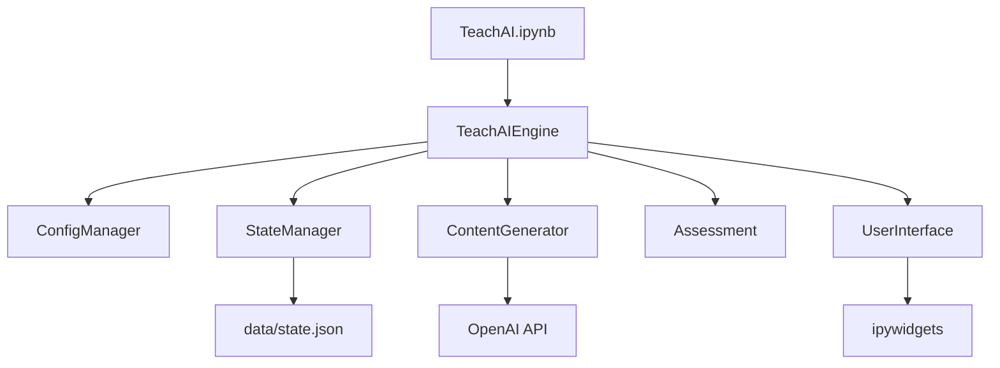

# ТЗ на презентацию дипломного проекта TeachAI (рабочая версия)

> **⚠️ Не основной пакет для внешней ИИ.** Актуальные файлы (v2.0, сентябрь 2026):
> 1. [`Описание_проекта_TeachAI_для_презентации.md`](Описание_проекта_TeachAI_для_презентации.md)
> 2. [`Бриф_слайды_TeachAI.md`](Бриф_слайды_TeachAI.md) — **17 слайдов**, эксперимент моделей **включён**
>
> Этот файл — внутренний черновик мая 2026. Решение «удалить слайд 11» **отменено** после бенчмарка этапа 5.
>
> **Статус:** не синхронизировать вручную; править v2.0.

---

## Часть 0. Рамки

### Аудитория и цель

| Параметр | Значение |
|----------|----------|
| Аудитория | Защита дипломного проекта AI/ML |
| Акцент | Проблема и решение; инженерия; подход LLM (без бизнес-части) |
| Регламент | 15–20 минут |

### Согласовано с куратором (не оспаривать на защите)

- Нет сбора обучающей базы, обучения и дообучения своей модели
- Нет RAG
- Нет парсинга как этапа подготовки датасета
- Этапы 2–3 пройдены с пояснениями в `Об отсутствии сбора базы данных и дообучения модели.md` и `Об отсутствии парсинга.md`

### Запрещено в презентации и в этом ТЗ (явный запрет автора)

- **Слайд «эксперименты с промптами / таблица версий промптов»** — темы нет в проекте, **не включать**
- **Любые количественные метрики качества 95% / 90% / 85%** (и аналоги) — **не использовать**; в проекте не было измерений, ранее попали из черновиков ИИ

### Нормативные документы

- `doc/Этапы итогового проекта AI_ML (MarkText).md` (этап 6–7, рекомендации по слайдам)
- `doc/!Инструкция. Дипломный проект AI_ML.pdf`
- `doc/📖 Требования к итоговому проекту (AI_CV_ML_GPT).pdf` — с учётом согласованных исключений для TeachAI
- Шаблон: `Шаблон презентации.pptx` (17 слайдов)

### Правила оформления (из методички + шаблон)

- Мало текста на слайде; предпочтительно схемы и таблицы
- Код на слайдах — только при необходимости
- Не вести защиту «на фоне открытого ноутбука»; демо — отдельно по решению автора

### Решение по слайду 11 шаблона

**Май 2026:** тема «эксперименты с промптами» исключена (журнала версий промптов не было).

**Сентябрь 2026 (отмена):** слайд 11 **вернуть** — методика сравнения **моделей** (бенчмарк 13.09.2026). Слайд 12 — результаты и вердикт. Это не таблица версий промптов и не 95/90/85.

При сборке `.pptx`: заполнять шаблон на 17 слайдов по брифу v2.0.

---

## Часть 1. Карточки слайдов

Ниже для каждого слайда шаблона — поля для заполнения после анализа кода.  
**Статус:** `пусто` | `черновик` | `нужен ввод автора` | `согласовано`

---

### Слайд 1 — Титул (шаблон: название, ФИО, дата защиты, поток)

| Поле | Содержание |
|------|------------|
| Заголовок на слайде | **TeachAI** — интеллектуальная система персонализированного обучения на основе LLM |
| Смысл для слушателя | Идентификация работы; соответствие полям шаблона (название, автор, даты, поток). |
| Буллеты на слайд | Поля шаблона (не буллеты):<br>• **ФИО:** Игорь Пучкин *(проверить официальное написание)*<br>• **Курс:** AI/ML - разработчик<br>• **Старт обучения:** _[ввод автора]_<br>• **Дата защиты:** _[ввод автора]_ |
| Визуал | Только шаблон титула, без доп. текста |
| Голосом (~30 сек) | «Дипломный проект TeachAI — прикладная система обучения с GPT через API в Jupyter.» |
| Не выносить на слайд | Цели и задачи (это слайды 3–4) |
| Привязка к коду | Название проекта: `README.md`, репозиторий TeachAI |
| **Статус** | нужен ввод автора (даты) |

---

### Слайд 2 — Постановка задачи

| Поле | Содержание |
|------|------------|
| Заголовок на слайде | Постановка задачи |
| Смысл для слушателя | Объяснить, какую инженерную и ML-задачу решает диплом: персонализированное обучение без собственного обучения модели. |
| Буллеты на слайд | • Подготовка структурированного курса (план → уроки → примеры → проверка) требует много ручной работы<br>• Типовой курс плохо учитывает темп и стиль общения конкретного обучающегося<br>• Нужна **прикладная система**, которая генерирует и ведёт обучение через **готовую LLM**, а не обучает свою модель |
| Визуал | Схема «вход: тема + профиль студента → выход: интерактивный курс» (без деталей модулей) |
| Голосом (~2 мин) | Кратко: проблема не в «рынке EdTech», а в том, что качественный персонализированный контент сложно делать вручную. Решение — TeachAI: оркестрация вызовов GPT и прикладная логика вокруг ответов модели. |
| Не выносить на слайд | Сравнение с Coursera; бизнес-эффект; цифры качества |
| Привязка к коду | Точка входа: `TeachAIEngine` (`engine.py`) — координация `ContentGenerator`, `StateManager`, `Assessment`, UI |
| **Статус** | черновик — **утвердить формулировку проблемы** |

---

### Слайд 3 — Цель

| Поле | Содержание |
|------|------------|
| Заголовок на слайде | Цель проекта |
| Смысл для слушателя | Одна чёткая цель диплома: что должна уметь система в итоге. |
| Буллеты на слайд | • Разработать систему **TeachAI** для **автоматической генерации персонализированного учебного контента**<br>• Использовать **предобученную LLM через API** (inference), без сбора датасета и без fine-tuning<br>• Обеспечить прохождение курса в **Jupyter** с интерактивным UI и сохранением прогресса |
| Визуал | Можно без отдельной схемы — крупный текст цели (1–3 строки) |
| Голосом (~1 мин) | Цель совпадает с тем, что реально делает `engine.start()`: от настройки профиля до уроков, Q&A и оценивания. |
| Не выносить на слайд | «Создать новую нейросеть»; обучение на своих данных |
| Привязка к коду | README, `ОПИСАНИЕ_ПРОЕКТА_TEACHAI.md` (раздел «Назначение и цели»); реализация — `engine.py`, `interface.py` |
| **Статус** | черновик |

---

### Слайд 4 — Задачи

| Поле | Содержание |
|------|------------|
| Заголовок на слайде | Задачи проекта |
| Смысл для слушателя | Перечислить, **что именно реализовано в коде** — как декомпозиция цели. |
| Буллеты на слайд | • **Генерация контента:** план курса, уроки, примеры, тесты, ответы на вопросы (фасад `ContentGenerator` и отдельные генераторы)<br>• **Персонализация:** профиль — стиль общения, длительность занятия, объём курса (`user_profile_manager.py`)<br>• **Интерактивность:** UI на ipywidgets, сценарий урока и Q&A (`interface.py`, `lesson_*`)<br>• **Контроль качества LLM:** валидация структуры плана курса; при запросе примеров — эвристическая проверка и при необходимости перегенерация; при вопросе студента — проверка релевантности вопроса к уроку<br>• **Учёт прогресса:** курс, уроки, оценки в `data/state.json` (`state_manager.py`) |
| Визуал | Нумерованный список 5 пунктов (как в шаблоне «Задачи») |
| Голосом (~2 мин) | По каждой задаче — один пример. Для контроля качества: «план — JSON-валидация», «примеры — только при кнопке „Примеры“», «вопрос студента — RelevanceChecker до ответа Q&A». |
| Не выносить на слайд | Имена файлов на слайде; RAG, парсинг, fine-tuning; общая фраза «везде валидация» |
| Привязка к коду | См. **разбор слайда 4** ниже |
| **Статус** | согласовано (2026-05-19) |

#### Разбор слайда 4 (проверка по коду — не на слайд целиком)

**`examples_validation.py` — не «мертвый», но узкий сценарий**

- Вызывается **только** из цепочки генерации примеров: `ExamplesGenerator.generate_examples()` → `validate_and_regenerate_if_needed()`.
- В штатном UI — когда пользователь запрашивает **практические примеры** (`lesson_interactive_handlers.py`, `lesson_navigation.py` → `content_generator.generate_examples()`).
- Первая проверка — **эвристика по тексту** (`validate_examples_relevance`: паттерны HTML/JS и т.п.), **без вызова LLM**. Дополнительный запрос к API — только если эвристика не прошла (`regenerate_with_strict_prompt`), иначе примеры возвращаются как есть.
- Вывод для защиты: модуль **в рабочем пути**, но не «глобальный валидатор всего контента»; на слайде 4 лучше формулировать как контроль **примеров к уроку**, не путать с Q&A.

**`relevance_checker.py` — вы правы по назначению**

- Используется для **вопросов студента к уроку**: `check_question_relevance()` → при нерелевантности `generate_non_relevant_response()`, иначе `answer_question()`.
- Точки входа: `lesson_interactive_handlers.py` (обработчик поля вопроса), `lesson_interaction.py` (альтернативный поток Q&A).
- Проверка — **отдельный вызов LLM** (JSON-ответ, `temperature=0.2`), по метаданным урока (название, описание, ключевые слова), не по полному тексту урока в промпте.
- Методы `generate_multiple_questions_warning` / `get_formatted_answer_with_relevance` в `content_generator.py` **нигде больше не вызываются**; напоминание после нескольких вопросов даёт `append_question_reminder()` в обработчиках.

**Прочий контроль качества (для полноты слайда 4, устно)**

- План курса: `_validate_and_fix_course_plan` в `course_plan_generator.py` (структура JSON).
- Ответы на задания/тесты: `assessment.py`, `result_checker.py` (отдельная ветка, не `relevance_checker`).

---

### Слайд 5 — «Обучающая база» → переименовать: **Данные и модель**

> Содержание не про датасет: предобученная LLM, API, параметры запросов, согласованное отсутствие своей БД/RAG.

| Поле | Содержание |
|------|------------|
| Заголовок на слайде | **Данные и модель** *(вместо «Обучающая база» в шаблоне)* |
| Смысл для слушателя | Честно закрыть вопрос куратора «где база»: её нет как датасета для обучения; есть модель-провайдер и рабочие данные сессии. |
| Буллеты на слайд | • **Модель:** предобученная LLM через **OpenAI API** (inference)<br>• **Модель в дипломе:** **`gpt-4o-mini`** (переменная **`LLM_MODEL`** в `.env`)<br>• **По задачам меняются** не модель, а **параметры:** `temperature`, `max_tokens`, `response_format`<br>• **Свой датасет / RAG / парсинг / fine-tuning:** не используются *(согласовано)*<br>• **Данные сессии:** `data/state.json` — профиль, план, прогресс *(не обучающая выборка)* |
| Визуал | Таблица из 2 колонок: «Что есть» / «Чего нет» ИЛИ блок-схема: API → генераторы → state.json |
| Голосом (~2 мин) | Прямая отсылка к согласованным этапам 2–3: «база в классическом ML-смысле отсутствует; знания — в предобученной модели; мы управляем качеством промптами и валидацией». |
| Не выносить на слайд | Объём базы в ГБ/тыс. примеров; 95/90/85; «векторное хранилище» |
| Привязка к коду | `content_utils.py` — `self.model = os.getenv("LLM_MODEL", "gpt-4o-mini")`, в API передаётся `self.model`; `config.py` — `LLM_MODEL` в `.env.sample`; модуль **`llm.py` удалён** |
| **Статус** | обновлено (2026-05-19, смена модели) |

#### Слайд 5 — модель (актуально по коду)

- Все генераторы наследуют **базовый класс** с единым клиентом OpenAI и полем **`self.model`**.
- Модель читается из **`LLM_MODEL`**; fallback в коде: **`gpt-4o-mini`**.
- В `make_api_request` в запрос подставляется **`"model": self.model`** (не жёсткая строка в каждом модуле).
- Модуль **`llm.py` удалён** — альтернативные провайдеры через него больше не используются.

**Для защиты:** модель **`gpt-4o-mini`** (`LLM_MODEL` в `.env`). Устно: «модель задаётся в конфигурации, во всех генераторах одна». 

---

### Слайд 6 — Схема: общая архитектура

| Поле | Содержание |
|------|------------|
| Заголовок на слайде | Архитектура системы |
| Смысл для слушателя | Показать **инженерную** декомпозицию: один оркестратор и связанные подсистемы, без «одного скрипта с промптом». |
| Буллеты на слайд | • **TeachAIEngine** — инициализация и запуск<br>• **ConfigManager** — `.env`, API-ключ, прокси<br>• **StateManager** — профиль, план курса, прогресс (`data/state.json`)<br>• **ContentGenerator** — обращения к LLM (фасад генераторов)<br>• **Assessment** — тесты и проверка ответов<br>• **UserInterface** — Jupyter UI (ipywidgets) |
| Визуал | Блок-схема (см. ниже). Центр: `TeachAIEngine`; стрелки к перечисленным модулям. |
| Голосом (~2 мин) | «Система слоистая: конфиг и состояние отделены от генерации и UI. Все вызовы GPT идут через ContentGenerator, интерфейс только оркестрирует сценарий обучения.» |
| Не выносить на слайд | Список всех ~60 файлов; `llm.py` (не в основной цепочке) |
| Привязка к коду | `engine.py` (`initialize`, `start`); связи в `__init__` и `initialize()` |
| **Статус** | черновик |

**Эскиз схемы для вёрстки слайда 6:**



---

### Слайд 7 — Схема + текст: многошаговая генерация

| Поле | Содержание |
|------|------------|
| Заголовок на слайде | Генерация контента (многошаговые вызовы LLM) |
| Смысл для слушателя | Обосновать **сложность LLM-части**: не один запрос, а цепочка специализированных генераторов с разными промптами. |
| Буллеты на слайд | • Фасад **ContentGenerator** делегирует задачи модулям<br>• Отдельные вызовы LLM: план курса, урок, примеры, тест, Q&A, понятия, релевантность вопроса<br>• У каждого модуля — **свой промпт** и параметры (`temperature`, `response_format`)<br>• Ответы постобрабатываются (HTML, JSON, стили) |
| Визуал | Схема: `ContentGenerator` → 7–8 генераторов → OpenAI API. Можно 2 колонки: «тип контента» / «модуль». |
| Голосом (~2 мин) | Пример цепочки: «сначала план курса в JSON, при открытии урока — отдельный запрос на текст урока, по кнопке — примеры, при вопросе студента — сначала relevance, потом ответ». |
| Не выносить на слайд | Таблица экспериментов; RAG |
| Привязка к коду | `content_generator.py`; генераторы: `course_plan_generator`, `lesson_generator`, `examples_generator`, `assessment_generator`, `qa_generator`, `concepts_generator`, `relevance_checker`, `explanation_generator` |
| **Статус** | черновик |

**Список для подписей на схеме (слайд 7):**

| Контент | Модуль |
|---------|--------|
| План курса | `CoursePlanGenerator` |
| Текст урока | `LessonGenerator` |
| Примеры | `ExamplesGenerator` (+ `ExamplesValidation`) |
| Тест | `AssessmentGenerator` |
| Ответ на вопрос | `QAGenerator` |
| Пояснение понятия | `ExplanationGenerator` / `ConceptsGenerator` |
| Релевантность вопроса | `RelevanceChecker` |

---

### Слайд 8 — Схема + текст: промпты и контроль ответов

| Поле | Содержание |
|------|------------|
| Заголовок на слайде | Промпты и контроль качества ответов LLM |
| Смысл для слушателя | Показать **инженерию вокруг модели**, а не метрики: как задаётся формат и как отсекаются плохие ответы. |
| Буллеты на слайд | • Промпты с требованиями к формату (в т.ч. JSON для плана и проверки релевантности)<br>• **План курса:** разбор JSON + исправление структуры<br>• **Примеры:** эвристическая проверка; при сбое — повторный запрос к LLM<br>• **Вопрос студента:** отдельный LLM-шаг «релевантен ли вопрос уроку»<br>• **Тест:** вопросы генерирует LLM; проверка ответа — по ключу в данных вопроса |
| Визуал | Блок-схема «запрос → ответ → проверка → (повтор / показ пользователю)» для 2–3 веток (план, примеры, вопрос). |
| Голосом (~2 мин) | Подчеркнуть: это не обучение модели, а **контракты на выход** (JSON, стиль Python) и **ветвление** до показа студенту. |
| Не выносить на слайд | 95/90/85; «глобальная валидация всего контента» |
| Привязка к коду | `course_plan_generator._validate_and_fix_course_plan`; `examples_validation`; `relevance_checker.check_question_relevance`; `assessment.check_answer` |
| **Статус** | черновик |

---

### Слайд 9 — Схема + текст: сценарий обучения / UI

| Поле | Содержание |
|------|------------|
| Заголовок на слайде | Сценарий работы и интерфейс |
| Смысл для слушателя | Связать архитектуру с **пользовательским путём** в Jupyter. |
| Буллеты на слайд | • Старт: `engine.start()` — настройка профиля или дашборд продолжения<br>• Выбор курса → генерация **плана** → сохранение в state<br>• Урок: генерация (или кэш) → просмотр → примеры / вопрос / тест<br>• Прогресс и оценки пишутся в **state.json**<br>• UI: фасад `UserInterface` → Setup / Lesson / Assessment / Completion |
| Визуал | Линейная схема 5–7 шагов с иконками этапов (без скриншота ноутбука на этом слайде). |
| Голосом (~2 мин) | Пройти путь «как студент»: один раз настроился — дальше система ведёт по плану, LLM вызывается по событиям (урок, кнопка, вопрос). |
| Не выносить на слайд | Демо live в ноутбуке (это слайд 10); интеграция demo-ячеек (`CELLS_INTEGRATION_AVAILABLE = False` в `lesson_display.py`) |
| Привязка к коду | `engine.start()`; `setup_interface`; `lesson_display.show_lesson`; `lesson_interactive_handlers`; `assessment_interface`; `InterfaceState` в `interface_utils.py` |
| **Статус** | черновик |

**Эскиз сценария (слайд 9):**

```
Профиль и курс → План курса (LLM) → Урок (LLM/кэш) → [Примеры | Вопрос | Тест] → Прогресс в state.json
```

---

### Слайд 10 — Подпись к иллюстрации / демо

| Поле | Содержание |
|------|------------|
| Заголовок на слайде | Запуск системы (точка входа) |
| Смысл для слушателя | Показать минимальный **рабочий вход** — соответствие критерию «friendly UI» из этапа 5. |
| Буллеты на слайд | • Точка входа: ноутбук **TeachAI.ipynb**<br>• `TeachAIEngine().start()` → виджет интерфейса<br>• Требования: Python 3.10+, `.env` с API-ключом и прокси<br>• Подпись под рисунком: «Интерактивный прототип в Jupyter» |
| Визуал | Скрин **одного** экрана: дашборд или форма настройки / экран урока (без мелкого кода). Рядом — 3–4 строки кода входа (крупно). |
| Голосом (~1 мин) | «Для проверки достаточно запустить ноутбук; вся логика уже в модулях, ячейка только стартует движок.» |
| Не выносить на слайд | Полный листинг проекта; демо «вживую» на фоне IDE (по рекомендации методички) |
| Привязка к коду | `TeachAI.ipynb` (импорт `TeachAIEngine`, `display(engine.start())`); `README.md` |
| **Статус** | черновик — **нужен скрин от автора** |

**Код для подписи на слайде (4 строки):**

```python
from engine import TeachAIEngine
from IPython.display import display

engine = TeachAIEngine()
display(engine.start())
```

---

### Слайд 11 — **ИСКЛЮЧЁН**

| Поле | Содержание |
|------|------------|
| Решение | **Не заполнять.** Тема «эксперименты с промптами» отсутствует в проекте. |
| При сборке pptx | Удалить слайд или не использовать (см. часть 0) |
| **Статус** | согласовано (исключение) |

---

### Слайд 12 — Несколько блоков / модульная структура

| Поле | Содержание |
|------|------------|
| Заголовок на слайде | Модульная структура проекта |
| Смысл для слушателя | Показать **инженерную зрелость**: не монолит, а слои и фасады (критерий этапа 5). |
| Буллеты на слайд | На слайде — **4 блока** (подписи к 4 «картинкам» шаблона):<br>1. **Ядро** — `engine`, `config`, `state_manager`<br>2. **LLM** — `content_generator` + генераторы контента<br>3. **UI** — `interface`, `lesson_*`, `setup_*`, `assessment_interface`<br>4. **Сервис** — `logger`, `loading_indicators`, форматирование, `control_tasks_*` |
| Визуал | 4 иконки/блока по слоям; стрелки «ядро → LLM/UI». ~55 Python-модулей в корне (без `venv`). |
| Голосом (~1,5 мин) | «Каждый слой можно менять отдельно: новый генератор — в LLM-слой, не трогая UI. Состояние вынесено в StateManager с подменеджерами профиля и прогресса.» |
| Не выносить на слайд | `create_presentation*.py`, `fix_*`, `temp_code.py`, `llm.py` (не в основном пути) |
| Привязка к коду | Структура каталога репозитория; README «Архитектура проекта» |
| **Статус** | черновик |

**Подписи к 4 блокам на макете слайда 12:**

| Блок | Ключевые файлы |
|------|----------------|
| Ядро | `engine.py`, `config.py`, `state_manager.py`, `user_profile_manager.py`, `learning_progress_manager.py`, `course_data_manager.py` |
| LLM | `content_generator.py`, `*_generator.py`, `relevance_checker.py`, `content_utils.py` |
| UI | `interface.py`, `setup_interface.py`, `lesson_interface.py`, `lesson_display.py`, `lesson_interactive_handlers.py`, `assessment_interface.py` |
| Сервис | `logger.py`, `startup_dashboard.py`, `loading_indicators.py`, `content_formatter*.py`, `control_tasks_interface.py` |

---

### Слайд 13 — «Большой объём» → **Технологический стек**

| Поле | Содержание |
|------|------------|
| Заголовок на слайде | Технологический стек |
| Смысл для слушателя | Зафиксировать стек **реализации**, не «ML-стек обучения». |
| Буллеты на слайд | • **Язык:** Python 3.10+<br>• **Среда:** Jupyter Notebook / IPython<br>• **UI:** ipywidgets<br>• **LLM:** OpenAI API (`openai`, `httpx`), модель **`gpt-4o-mini`** (`LLM_MODEL` в `.env`)<br>• **Конфиг:** `python-dotenv` (`.env`: ключ, прокси)<br>• **Данные сессии:** JSON (`data/state.json`)<br>• **Доп.** (в зависимостях, для примеров/отображения): pandas, matplotlib — не ядро LLM-пайплайна |
| Визуал | Компактная таблица «компонент → технология» |
| Голосом (~1 мин) | «Это прикладной Python-проект вокруг API готовой модели, не свой training pipeline.» |
| Не выносить на слайд | PyTorch/TensorFlow как «основа проекта»; 21k строк (если не пересчитано) |
| Привязка к коду | `requirements.txt`, `config.py`, `content_utils.py` |
| **Статус** | черновик |

---

### Слайд 14 — «Большой объём» → **Обеспечение качества (механизмы)**

> Не метрики и не графики обучения — только инженерные средства контроля ответов LLM.

| Поле | Содержание |
|------|------------|
| Заголовок на слайде | Обеспечение качества (инженерные механизмы) |
| Смысл для слушателя | Чем заменяем «метрики обучения НС»: контракты на выход LLM и постобработка. |
| Буллеты на слайд | • **Промпты:** формат, стиль, предмет (Python), JSON где нужно<br>• **План курса:** парсинг JSON + `_validate_and_fix_course_plan`<br>• **Примеры:** эвристика релевантности → при сбое повторный запрос / fallback<br>• **Вопрос студента:** `RelevanceChecker` до генерации ответа<br>• **Тест:** LLM формирует вопросы; проверка по эталону в структуре вопроса<br>• **Отладка:** `debug_responses/`, логи (`logs/teachai.log`) — для разработки, не для защиты как «метрики» |
| Визуал | Таблица «этап → механизм контроля» (3–4 строки) |
| Голосом (~1,5 мин) | «Качество обеспечивается не дообучением, а цепочкой проверок до показа пользователю.» |
| Не выносить на слайд | 95/90/85; confusion matrix; «обучающая выборка» |
| Привязка к коду | См. слайды 4, 8; `course_plan_generator`, `examples_validation`, `relevance_checker`, `assessment.check_answer` |
| **Статус** | черновик |

---

### Слайд 15 — «Большой объём» → **Почему inference, а не обучение**

| Поле | Содержание |
|------|------------|
| Заголовок на слайде | Предобученная LLM без дообучения |
| Смысл для слушателя | Закрыть вопрос комиссии «почему нет своей НС / датасета» — со ссылкой на согласование. |
| Буллеты на слайд | • Задача — **прикладная система обучения**, не тренировка модели<br>• **Prompt engineering** + валидация вместо fine-tuning<br>• **Плюсы:** любая тема курса, без GPU и размеченного корпуса<br>• **Согласовано с куратором:** нет сбора БД, RAG, парсинга, дообучения (этапы 2–3)<br>• Модель **`gpt-4o-mini`** (`LLM_MODEL`) — единая в рабочих генераторах |
| Визуал | Схема «GPT (готовая) → промпты + код системы → учебный контент» |
| Голосом (~1,5 мин) | Кратко повторить позицию из писем куратору; не спорить с требованием RAG из общей PDF — у вас **индивидуальное согласование**. |
| Не выносить на слайд | Сравнение «мы лучше fine-tuning»; цифры качества |
| Привязка к коду | `Об отсутствии сбора базы данных и дообучения модели.md`; архитектура inference в `content_utils.make_api_request` |
| **Статус** | черновик |

---

### Слайд 16 — Выводы

| Поле | Содержание |
|------|------------|
| Заголовок на слайде | Выводы |
| Смысл для слушателя | Итог **достигнутого** (без выдуманных метрик). |
| Буллеты на слайд | • Реализована модульная система **TeachAI** в Jupyter с интерактивным UI<br>• Построен **многошаговый пайплайн** вызовов LLM под задачи обучения<br>• Реализованы **персонализация** (профиль, стиль) и **сохранение прогресса**<br>• Качество контента обеспечивается **промптами и валидацией**, не дообучением<br>• Подтверждён с куратором подход **inference-only** без своего датасета |
| Визуал | 4–5 коротких тезисов крупным шрифтом |
| Голосом (~1 мин) | «Главный результат — работающий прототип и понятная архитектура, которую можно развивать.» |
| Не выносить на слайд | «Достигли 95% точности»; планы из слайда 17 |
| Привязка к коду | Итог по разделам ТЗ слайдов 2–15 |
| **Статус** | черновик — **утвердить формулировки** |

---

### Слайд 17 — Заключение

| Поле | Содержание |
|------|------------|
| Заголовок на слайде | Заключение |
| Смысл для слушателя | Вежливое завершение; **только реальные** направления развития. |
| Буллеты на слайд | • **Спасибо за внимание!**<br>• Возможные направления *(оставить только те, что планируете — иначе удалить)*:<br>  — веб-интерфейс (API + UI вне Jupyter)<br>  — расширение сценариев оценивания<br>  — включение интерактивных учебных ячеек (сейчас отключены в коде)<br>  — сравнение моделей (gpt-4o-mini vs gpt-4o) *только если планируете эксперименты* |
| Визуал | Минимум текста; контакты — по желанию |
| Голосом (~30 сек) | Благодарность; 1 предложение о ближайшем шаге, если есть. |
| Не выносить на слайд | RAG/fine-tuning как «скоро сделаем», если не планируется |
| Привязка к коду | `lesson_display.py`: `CELLS_INTEGRATION_AVAILABLE = False` — честно, если упоминаете ячейки |
| **Статус** | черновик — **согласовать список «развитие»** |

---

## Часть 2. Приложение

### Утверждения, требующие подтверждения автором

- [ ] ФИО, поток, даты на титуле
- [ ] Финальная формулировка названия диплома
- [x] Удалять ли физически слайд 11 в `.pptx` — **да, вариант A**
- [x] Модель: **`gpt-4o-mini`** (`LLM_MODEL` в `.env`); `llm.py` удалён (2026-05-19)
- [ ] Что показывать на защите как демо (ноутбук / скрин / без live-демо)
- [ ] Список пунктов «дальнейшее развитие» на слайде 17 — только реальные планы автора

### Чеклист перед сборкой презентации

- [ ] Все слайды из шаблона либо заполнены, либо явно исключены (слайд 11)
- [ ] Нет 95/90/85 и «экспериментов с промптами»
- [ ] Слайд 5 переименован и не выглядит как «собрали датасет»
- [ ] Текст слайдов укладывается в регламент 15–20 мин (репетиция)
- [ ] Каждый тезис на защите можно объяснить по коду

### Журнал изменений ТЗ

| Дата | Изменение |
|------|-----------|
| 2026-05-19 | Создан скелет; исключены слайд 11 (эксперименты) и метрики 95/90/85 |
| 2026-05-19 | Согласовано удаление слайда 11 (вариант A); заполнены черновики слайдов 2–5 по коду |
| 2026-05-19 | Слайд 4: уточнены роли `examples_validation` (примеры, эвристика) и `relevance_checker` (вопросы студента) |
| 2026-05-19 | Заполнены черновики слайдов 6–10 (архитектура, LLM-цепочка, контроль, сценарий, вход) |
| 2026-05-19 | Слайд 5: модель **gpt-4o-mini** (`LLM_MODEL`); `llm.py` удалён |
| 2026-05-19 | Заполнены черновики слайдов 1, 12–17 |
| 2026-05-19 | v1.2: исправления после тестирования (релевантность, примеры, кэш, контрольные) |
| 2026-10-05 | Слайды 13 и 15: модель исправлена `gpt-3.5-turbo-16k` → `gpt-4o-mini` (синхронизация с v2.0/v2.2). Файл остаётся черновиком-не-каноном |
