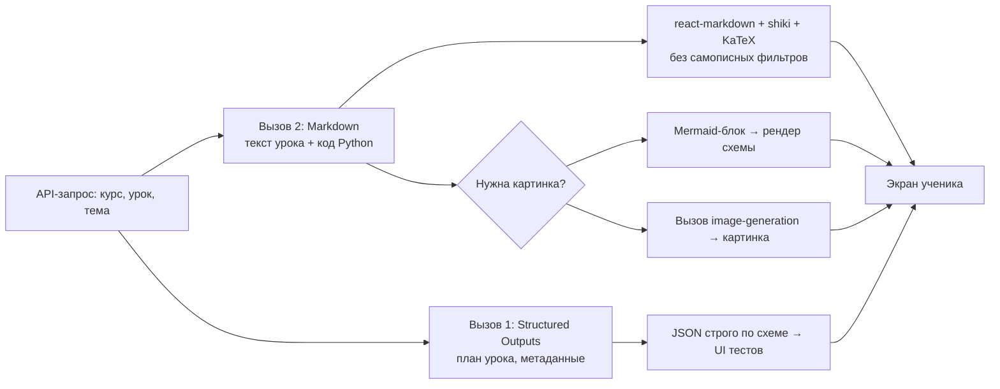

# Форматы ответов нейросетей по API: решены ли старые проблемы?

*Дата подготовки: 18 октября 2026 г. Ответ на вопрос о качестве и надёжности форматирования ответов современных LLM (OpenAI и др.) при работе через API, и о том, какой формат ответа требовать для учебного приложения («нейроучитель»).*

## Краткий вывод

Старые проблемы отображения смешанного вывода LLM (русский текст + код Python + служебные символы разметки) сегодня в значительной мере решены — но иначе, чем «просим формат и выводим как есть». Произошли два сдвига:

1. Для **JSON** появились **гарантии на уровне генерации токенов** (Structured Outputs) — модель физически не может выдать ответ, не соответствующий схеме.
2. Для **Markdown** сложился **зрелый стандарт отображения**: готовые рендереры, на которых построены все современные чат-интерфейсы. Самописные фильтры-«костыли» больше не нужны, но и «вывод без обработки» в чистом виде не нужен — обработку теперь делает стандартная библиотека.

---

## 1. Что изменилось: гарантии формата вместо «надежд на промпт»

Раньше просьба «ответь в JSON» была просто текстом в промпте — модель могла её нарушить. Сейчас у провайдеров есть **constrained decoding**: схема компилируется в грамматику, и на уровне генерации каждого токена модель не может выдать ничего, что ей противоречит.

### Как это выглядит у OpenAI (GPT-4o, GPT-4.1/5-й серии и новее)

- В API появился режим `response_format: {type: "json_schema", strict: true}` — вы передаёте JSON-схему, и ответ гарантированно соответствует ей. По собственным замерам OpenAI это **100% соответствия схеме** против ~86% у function calling и ещё ниже у старого JSON mode.
- Старый **JSON mode** (`{"type": "json_object"}`) гарантирует только *синтаксически валидный* JSON — но не наличие нужных полей и их типов. OpenAI прямо рекомендует всегда использовать Structured Outputs вместо JSON mode; в гайдах 2026 года JSON mode уже называют «legacy».
- Практические бенчмарки это подтверждают: на сложных схемах JSON mode ломается примерно в ~20% случаев, Structured Outputs с strict-режимом — 0%.

### Это не только OpenAI

Аналогичные механизмы есть у всех крупных провайдеров: у Anthropic — через tool use с `input_schema` (тоже constrained decoding — модель «буквально не может» выдать токены, нарушающие схему), у Gemini — `responseSchema`, у Mistral — свой `json_schema`. Но уровень гарантий зависит от провайдера: где-то это жёсткое ограничение, где-то — лишь «сильная подсказка».

### Нюансы, о которых стоит знать

- Structured Outputs поддерживают только подмножество JSON Schema (ограничение глубины вложенности, все поля должны быть в `required` и т.п.), и первый запрос с новой схемой даёт дополнительную задержку на её компиляцию.
- **Формат ≠ содержание.** Бенчмарки 2026 года показывают: все модели дают почти идеальный JSON *по структуре*, но в 15–25% случаев значения внутри полей ошибочны — «валидный на вид» JSON не значит «правильный».
- Обрыв по лимиту токенов: если ответ упёрся в `max_tokens`, `finish_reason` будет `length`, и JSON окажется обрезанным — это надо проверять перед парсингом.

---

## 2. Насколько модели держат Markdown

Markdown — фактически «родной язык» современных LLM: модели отвечают им **по умолчанию**, даже без просьбы, и все чат-продукты (ChatGPT, Claude, Le Chat и т.д.) построены именно на рендеринге Markdown-ответа. Просьба «ответь в Markdown» фронтовыми моделями выполняется стабильно и хорошо.

Но важно понимать разницу: **у Markdown нет схемы и нет гарантий**. Это мягкое обещание, а не контракт. Что всё ещё иногда ломается в реальной практике:

- модель оборачивает JSON в ```json-забор, ломая парсинг (задокументированная проблема, например, у Gemini);
- незакрытые code-фенсы в середине ответа при стриминге;
- разнобой в таблицах, лишние «болтливые» обороты вокруг контента.

Поэтому идея «не переформатировать, а выводить как есть» сегодня почти верна — с одной поправкой: **обработку делает не самописный фильтр, а стандартный, отлаженный рендерер**. Промышленный стек сейчас выглядит так:

- **react-markdown** (+ `remark-gfm` для таблиц) — базовый рендер; LangChain документирует его как стандартный паттерн для отображения ответов LLM. Рендерить Markdown как plain text — значит терять всю структуру, которую модель даёт.
- Для стриминга токен-за-токеном — специализированные рендеры **Streamdown**, **markstream-react**, **LLMRender**, которые умеют переживать «недописанный» Markdown без мерцания и поломок макета.
- Согласованная лучшая практика для стриминга: буферизовать незавершённый Markdown (незакрытый `**` не должен ломать вёрстку) и **не рендерить блок кода, пока не пришла закрывающая фенса** — или рендерить прогрессивно с индикатором «генерируется».

---

## 3. Какой формат требовать для «нейроучителя»

Тут нужен компромисс, потому что у жёсткого JSON есть измеримый **«налог на качество»**: принуждение к жёсткой структуре снижает качество рассуждений и длинного текста примерно на 10–15%, а для длинных повествовательных текстов structured outputs прямо считаются неподходящими — «проза и есть ценность, жёсткая схема ей вредит». Кроме того, длинный русский текст внутри JSON-строк — это ещё и мука с экранированием переносов строк и лишними токенами.

| Подход | Гарантия формата | Качество учебного текста | Когда использовать |
|---|---|---|---|
| Markdown (ответ по умолчанию) | Нет формальной гарантии, но на практике стабильно | Максимальное — модель пишет «в родном формате» | Основной текст урока, код, объяснения |
| JSON mode (`json_object`) | Только валидный синтаксис JSON | Среднее | Устаревший вариант, не рекомендуется |
| Structured Outputs (`json_schema`, strict) | 100% соответствия схеме | Ниже на длинном тексте | Тесты, метаданные, структура урока |

### Рекомендация: гибрид из двух слоёв

1. **Основной учебный текст** — запрашивать как **Markdown** (с инструкцией в системном промпте: «язык — русский; весь код на Python — всегда в блоках ```python; формулы в LaTeX; не оборачивай ответ в code-фенсы целиком»). Рендерить стандартной связкой: react-markdown + remark-gfm + подсветка синтаксиса (shiki / highlight.js) + KaTeX для формул. **Отступы Python при этом сохраняются идеально** — рендерер выводит содержимое code-блока как есть, моноширинным шрифтом; это ровно та проблема, из-за которой раньше ломался вывод.

2. **Машиночитаемые части** (вопросы теста, ключ ответов, план урока, метаданные) — отдельным вызовом через **Structured Outputs** со схемой и `strict: true`. Тут гарантированный парсинг действительно нужен, и он теперь даётся «бесплатно» — retry-циклы и парсеры можно удалить.

3. **Картинки и графики.** Текстовые модели по API **не присылают изображения** — только текст. Для «нейроучителя» картинки делаются так: (а) модель в тексте оставляет placeholder/описание, а отдельный вызов image-generation создаёт изображение по этому описанию; (б) графы и схемы — модель генерирует код **Mermaid** в code-блоке, и рендерер рисует их как векторные диаграммы; (в) графики — модели хорошо пишут код на Python (matplotlib), который можно показать в code-блоке или исполнить.

### Архитектура обработки



---

## 4. Что всё ещё ломается (честный список)

- **Содержание при идеальном формате**: JSON может быть валидным по схеме, но с ошибочными значениями — нужна отдельная содержательная валидация, формат её не заменяет.
- **Обрыв по `max_tokens`**: проверяйте `finish_reason`, иначе получите обрезанный JSON или незакрытый code-блок.
- **Оборачивание JSON в фенсы** некоторыми моделями — если парсите JSON из свободного текста, сначала аккуратно снимайте code-fence.
- **Разные гарантии у провайдеров**: у строгих режимов разных API уровень enforcement отличается — где-то жёсткое ограничение, где-то «подсказка».
- **Незакрытые фенсы при стриминге** — решается правильным рендером, а не фильтром.

---

## Итог

Интуиция верна: правильная архитектура — **требовать формат в запросе и не переписывать ответ своими фильтрами**. Старая боль (самописная очистка и переформатирование смешанного вывода) сегодня устранена двумя путями: жёсткие машиночитаемые данные — через Structured Outputs с гарантированной схемой, а красивый учебный текст с кодом Python, формулами и схемами — через Markdown, который рендерится готовой библиотекой. Именно так работают все современные чат-продукты, и для «нейроучителя» это готовый, надёжный стек.

## Источники

1. OpenAI — Introducing Structured Outputs in the API — https://openai.com/index/introducing-structured-outputs-in-the-api/
2. OpenAI Docs — Structured model outputs — https://developers.openai.com/api/docs/guides/structured-outputs
3. Data Studios — OpenAI Structured Outputs vs JSON Mode: Schema Enforcement, Reliability, and Failure Modes — https://www.datastudios.org/post/openai-structured-outputs-vs-json-mode-schema-enforcement-reliability-and-failure-modes
4. Digital Applied — OpenAI Structured Outputs: Complete Developer Guide — https://www.digitalapplied.com/blog/openai-structured-outputs-complete-guide
5. Ergini — OpenAI Structured Outputs: Strict JSON Schema in 2026 — https://ergini.com/blog/openai-structured-outputs
6. OpenRouter — Structured Outputs: Type-Safe JSON Responses from AI Models — https://openrouter.ai/docs/guides/features/structured-outputs
7. mr.technology — Structured Output Without the Hallucination Hangover: JSON Schema Modes Compared — https://mr.technology/payloads/structured-output-json-schema-modes-compared-may-2026
8. arXiv — The Structured Output Benchmark — https://arxiv.org/html/2604.25359v1
9. Dev Community (nainikmehta) — JSON Mode vs. Structured Outputs: Stop LLM App Crashes — https://dev.to/nainikmehta/json-mode-vs-structured-outputs-stop-llm-app-crashes-oho
10. LangChain Docs — Markdown messages — https://docs.langchain.com/oss/javascript/langchain/frontend/markdown-messages
11. Streamdown / Medium (Daksh Khatri) — Rendering Streaming AI Responses with Streamdown.ai — https://medium.com/@dakshkhatri/rendering-streaming-ai-responses-with-streamdown-ai-using-nextjs-and-langchain-part-1-2-43e7785897d4
12. Markstream — React streaming Markdown renderer for AI chat — https://markstream.simonhe.me/frameworks/react
13. LLMRender — Markdown renderer for React — https://llmrender.com/
14. thefrontkit — AI Chat UI Best Practices for 2026 — https://thefrontkit.com/blogs/ai-chat-ui-best-practices
15. NeuralTrust — Output Length Control: Stop Token Waste — https://neuraltrust.ai/blog/output-length-control
16. Dev Community (rikuq) — Structured outputs vs JSON mode vs function calling vs raw text: the cost tradeoff explained — https://dev.to/rikuq/structured-outputs-vs-json-mode-vs-function-calling-vs-raw-text-the-cost-tradeoff-explained-471g
17. LLM Watch (Pascal Biese) — The Downsides of Structured Outputs — https://www.llmwatch.com/p/the-downsides-of-structured-outputs
18. FutureAGI — Evaluating LLM Structured Output Modes (2026) — https://futureagi.com/blog/evaluating-llm-structured-output-modes-2026/
19. GitHub (rahuloruganti/charbit) — Strip markdown code fences before parsing AI JSON responses — https://github.com/rahuloruganti/charbit/issues/9
20. GitHub (hossain-khan/android-compose-highlight) — Best practices for Streaming Markdown and LLM chat interfaces — https://github.com/hossain-khan/android-compose-highlight/issues/475
21. Deploybase — Best LLM for JSON Output: Structured Data Generation Compared — https://deploybase.ai/articles/best-llm-for-json-output-structured-data-generation