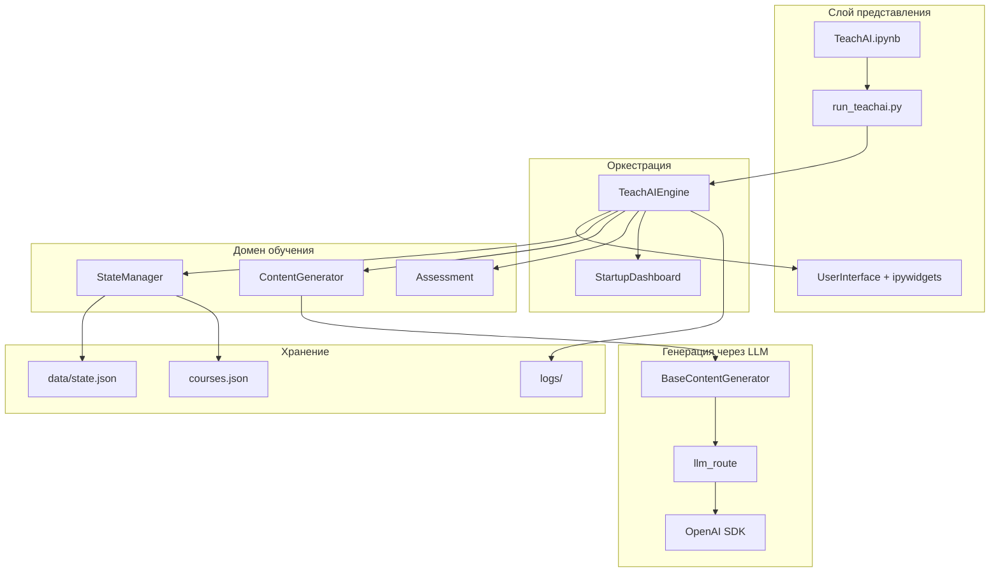

# Описание проекта TeachAI

Документ составлен **по анализу исходного кода** репозитория. Устаревшие описания не используются как источник фактов. Описание опирается на анализ исходного кода; при актуализации проверены затронутые утверждения, сплошная повторная сверка всех разделов не проводилась.

---

## 1. Цель и задачи проекта

### 1.1. Цель

Создать **интерактивного AI-учителя Python и AI/ML** в **Jupyter Notebook** (`TeachAI — интеллектуальная система персонализированного обучения Python и AI/ML на основе языковой модели`): персонализированный маршрут, генерация материалов и проверка усвоения без отдельного веб-сервера и без собственной обучаемой модели. Каталог курсов — Python, анализ данных и машинное обучение. Своё название курса модель относит к этой области или нет: вне области курс не стартует сам, его можно начать после предупреждения (`course_domain_ui.gate_custom_course`). Если проверку темы выполнить не удалось, курс не запускается. Исполняемая практика идёт в дочернем процессе Python (`code_sandbox.run_student_code`), не в ядре notebook.

Цель следует из назначения модулей:

- `engine.py` — «координация всех компонентов системы» TeachAI;
- `lesson_generator.py` — генерация «структурированных образовательных материалов»;
- `content_generator.py` — фасад генерации «уроков, вопросов и обработки ответов пользователя» через OpenAI;
- `interface.py` — «взаимодействие с пользователем через Jupyter Notebook».

### 1.2. Задачи (реализованные в коде)

| Задача | Реализация |
|--------|------------|
| Профиль обучающегося | `SetupInterface`, `UserProfileManager` — имя, часы обучения, длительность урока, стиль общения |
| Выбор курса из каталога или своё название | `courses.json`, `custom_course.py`, `course_selection_ui.py` |
| Портфель нескольких курсов | `course_portfolio.py` — слоты в `state["courses"]`, зеркало активного в корне |
| Построение учебного плана под время пользователя | `CoursePlanGenerator.generate_course_plan()` → сохранение в `state["course_plan"]` |
| Генерация содержания урока | `LessonGenerator` + `ContentFormatterFinal` |
| Интерактив на уроке: вопросы, примеры, объяснения, понятия | `LessonInteraction`, `QAGenerator`, `ExamplesGenerator`, `ExplanationGenerator`, `ConceptsGenerator` |
| Вопрос: материал урока, предмет курса или вне курса | `RelevanceChecker`: `lesson` / `course` / `outside` |
| Тестирование после урока | `Assessment`, `AssessmentGenerator`, `AssessmentInterface` |
| Практика с проверкой кода | `ControlTasksGenerator`, `ControlTasksInterface`, `InteractiveCellWidget`, `ResultChecker` |
| Учёт прогресса и возврат к незавершённому уроку | `LearningProgressManager`, `StartupDashboard`, `CourseDataManager.get_next_lesson()` |
| Логирование действий | `Logger` → `logs/` |
| Локальное хранение состояния | `StateManager` → `data/state.json` |

Задачи, **не** реализованные в текущем коде (для ясности границ проекта):

- дообучение / fine-tuning модели;
- централизованный сервер приложений (только клиент в notebook + API OpenAI);
- парсинг внешних учебников как основной источник контента (контент генерируется LLM по метаданным курса и плану).

---

## 2. Стек технологий

### 2.1. Язык и среда выполнения

- **Python 3** — нижняя граница версии в `requirements.txt` не задана
- **Jupyter Notebook** (`TeachAI.ipynb`, зависимости `jupyter`, `ipykernel`, `ipython`)
- **IPython.display** и **ipywidgets** — UI в notebook
- Имена `venv_H_L` и `venv_W_L` — примеры уже существующих окружений, не требование установки

### 2.2. Искусственный интеллект

- Клиент — пакет **`openai`** (`openai>=1.95.1`), вызов `client.chat.completions.create` (`BaseContentGenerator.make_api_request` в `llm_api_base.py`). Отдельного SDK шлюза нет.
- Модель чата по умолчанию: **`gpt-4o-mini`**, если не задана `LLM_MODEL` (`llm_api_base.BaseContentGenerator`).
- Для части валидации контрольных заданий: **`VALIDATION_MODEL`**; если её нет — `LLM_MODEL`, иначе снова `gpt-4o-mini` (`control_tasks_generator.ControlTasksGenerator.__init__`).
- Маршрут задаётся до учебного UI (`llm_route.py`): `direct`, `gptunnel` или `proxy`. Прокси приложения нужен только для `proxy`. `gptunnel` значением по умолчанию не является: без источников маршрута код выбирает `direct`. Шлюз использует `GPTUNNEL_API_KEY` и `base_url` (`GPTUNNEL_BASE_URL` или `https://gptunnel.ru/v1`); имя модели при этом не меняется.

### 2.3. Конфигурация и данные

- **python-dotenv** — `.env`. Если своего файла ещё нет: `test -f .env || cp .env.sample .env`. Существующий `.env` эта команда не перезаписывает.
- **JSON** — `courses.json`, `data/state.json`, логи в `logs/*.json`, сохранённый маршрут `data/llm_route_preference.json`

### 2.4. Отображение контента

- **markdown**, **pygments** — разметка и подсветка
- **latex2mathml** — формулы в HTML для виджетов (`content_renderer.py`)
- Собственные модули: `content_formatter_final.py`, `content_renderer.py`. Файла `code_formatter.py` в репозитории нет.

### 2.5. Предметные библиотеки (для примеров и контрольных заданий)

По `requirements.txt`, сгруппировано по курсам:

- Анализ данных: pandas, numpy, matplotlib, seaborn, scipy, openpyxl
- ML: scikit-learn, tensorflow
- Веб: flask, requests
- Финансы: yfinance

Они не требуются для импорта `engine.py`, но нужны, когда код ученика в дочернем процессе их импортирует.

### 2.6. Инфраструктура разработки

- `.pre-commit-config.yaml` — хуки качества (в runtime обучения не участвует)
- `pytest.ini`: обычный прогон `python -m pytest -q` добавляет `-m "not live"`. Маркер `live` — запрос к настоящей модели, по умолчанию выключен. Число прошедших тестов документом не фиксируется. Перед полным прогоном TeachAI и его ядро нужно остановить: фикстура `real_data_untouched` в `tests/conftest.py` сверяет время и размер `data/state.json`.
- Каталог `archive/` — старые notebook и презентации, **не** подключаются `run_teachai.py`

---

## 3. Общая архитектура

### 3.1. Слои системы



### 3.2. Главные компоненты

| Компонент | Файл | Роль |
|-----------|------|------|
| Точка входа | `run_teachai.py` | `start_jupyter(api_route=...)`, `main()`, опциональный `reload_project_modules()` |
| Движок | `engine.py` | `TeachAIEngine`: init, start, shutdown, проверка урока |
| Конфигурация | `config.py` | `.env`, каталоги `logs/` и `data/`; маршрут делегирует в `llm_route.py` |
| Маршрут LLM | `llm_route.py` | `direct` / `gptunnel` / `proxy`, ключ активного маршрута, клиент |
| Состояние | `state_manager.py` | Фасад над профилем, прогрессом, планом курса, кэшем уроков |
| Генерация | `content_generator.py` | Фасад над 8+ генераторами |
| Оценивание | `assessment.py` | Тесты, проверка ответов, связь с логгером |
| UI-фасад | `interface.py` | Маршрутизация экранов |
| Дашборд | `startup_dashboard.py` | Статистика при повторном запуске |
| Системный лог | `logger.py` | История уроков, вопросов, тестов, активности |

### 3.3. Специализация StateManager

`StateManager` делегирует:

- **UserProfileManager** — `state["user"]`
- **LearningProgressManager** — `state["learning"]`, завершённость уроков, оценки, счётчик вопросов
- **CourseDataManager** — `state["course_plan"]`, чтение `courses.json`, навигация `get_next_lesson()`

Дополнительные секции в `state.json` (создаются по мере работы):

- `lesson_content_cache` — HTML и `raw_content` уроков
- `control_tasks` — результаты контрольных заданий
- `system` — `first_run`, `last_access`, `version` (по умолчанию `"1.0.0"`)

### 3.4. Специализация UserInterface

Состояния интерфейса (`InterfaceState` в `interface_utils.py`):

`INITIAL_SETUP` → `COURSE_SELECTION` → `LESSON_VIEW` → (`ASSESSMENT` | `QUESTION_ANSWER` | …) → `COURSE_COMPLETION`

Реализации экранов:

- `SetupInterface` — профиль и выбор курса + вызов генерации плана
- `LessonInterface` — урок (делегаты: `LessonDisplay`, `LessonNavigation`, `LessonInteraction`)
- `AssessmentInterface` — тест
- `CompletionInterface` — завершение курса

### 3.5. Специализация ContentGenerator

| Генератор | Назначение |
|-----------|------------|
| `CoursePlanGenerator` | JSON-план: sections → topics → lessons |
| `LessonGenerator` | Текст урока (markdown) → HTML |
| `ExamplesGenerator` | Практические примеры (данные + HTML) |
| `ExplanationGenerator` | Расширенное объяснение |
| `ConceptsGenerator` | Ключевые понятия и объяснение понятия |
| `QAGenerator` | Ответ на вопрос по уроку |
| `AssessmentGenerator` | Вопросы теста |
| `RelevanceChecker` | Уровни `lesson` / `course` / `outside`; `reason` уровень не меняет |

Общая база: **`BaseContentGenerator`** в `llm_api_base.py` — клиент выбранного маршрута, retry, очистка HTML урока для промптов, отладочные дампы в `debug_responses/`. `content_utils.py` эти имена только реэкспортирует.

---

## 4. Pipeline AI-учителя: от запуска до ответа

### 4.1. Запуск системы

1. Сначала ячейка настройки в `TeachAI.ipynb`: `API_ROUTE = None` либо ровно `direct`, `gptunnel` или `proxy`. Затем ячейка Start: `start_jupyter(api_route=API_ROUTE)`. Это выбор до запуска, не виджет на учебном дашборде. Другие написания ячейка не принимает.
2. `start_jupyter` снимает явный маршрут прошлого запуска и возвращает снимок окружения (`release_notebook_api_route`), затем `load_dotenv(override=True)`.
3. `None` маршрут сам не назначает. Сохранённое предпочтение (`data/llm_route_preference.json`, `apply_saved_route_preference`) применяется только при пустом `OPENAI_API_ROUTE`. Если предпочтение не выбрано, используются совместимые `OPENAI_USE_PROXY` и `OPENAI_CONNECTION_MODE`, затем `direct`. Непустой `OPENAI_API_ROUTE` файл preference не читает: узнаваемое значение задаёт маршрут, неузнаваемое тоже не открывает файл и дальше идёт в те же совместимые переменные, затем `direct`.
4. Явные `direct`, `gptunnel`, `proxy` ставятся после загрузки `.env` и побеждают эту цепочку. В `.env` и в preference они не пишутся (`set_llm_route(..., persist=False)`).
5. Создаётся `TeachAIEngine()`, вызывается `engine.start()`. Клиент LLM при этом ещё не обязателен:
   - **Повторный запуск** (`state["system"]["first_run"] == false`): проверка `.env` и `StateManager`, показ `StartupDashboard`. `ContentGenerator` и клиент создаются по «Продолжить обучение», не до дашборда.
   - **Первый запуск**: `initialize()` создаёт генераторы и клиент до `UserInterface.show_initial_setup()`.

### 4.2. Первичная настройка и план курса

1. `SetupInterface.show_initial_setup()` — форма: имя, часы обучения (1–100), длительность урока (5–120 мин), стиль (`formal` | `friendly` | `casual` | `brief`).
2. Сохранение в `state["user"]`, `reset_learning_and_course_data()`, `first_run = false`.
3. `show_course_selection()` — каталог `courses.json` **или** своё название (`course_selection_ui.py`). Если курс уже есть в портфеле — продолжение без повторной генерации плана.
4. При подтверждении **нового** курса: `begin_new_course()` сохраняет предыдущий слот; `ContentGenerator.generate_course_plan(course_data, total_study_hours, lesson_duration_minutes)`:
   - промпт методиста → OpenAI с `response_format: json_object`;
   - валидация/нормализация `_validate_and_fix_course_plan`;
   - `save_course_plan()` в state.
5. Переход к первому уроку через навигацию (`get_next_lesson` / обработчики в `setup_interface`).

### 4.3. Показ урока

Цепочка в `LessonDisplay.show_lesson(section_id, topic_id, lesson_id)`:

1. Ключ кэша: `"{section_id}:{topic_id}:{lesson_id}"`.
2. Загрузка метаданных урока из `course_plan`.
3. **Кэш** (в порядке приоритета):
   - `state["lesson_content_cache"]` (постоянный);
   - in-memory кэш `LessonInterface`;
   - иначе **`LessonGenerator.generate_lesson(...)`**:
     - system: преподаватель, Markdown, код в ```lang языка темы;
     - user: промпт с курсом/разделом/темой/уроком и стилем;
     - `make_api_request(temperature=0.7, max_tokens=3500)`;
     - `ContentFormatterFinal.format_lesson_content()` → HTML;
     - сохранение `content` + `raw_content` (сырой ответ LLM до CSS).
4. `update_learning_progress()` — текущая позиция в курсе.
5. `Logger.log_lesson()` — запись в `logs/lesson_history.md`.
6. Сборка виджетов: HTML через `student_content.render_student_content()`, кнопки («Пройти тест», «Задать вопрос», «Объясни подробнее», «Приведи примеры», контрольное задание), навигация.

**Примечание из кода:** автоматическая вставка интерактивных ячеек через `cell_integration` в `lesson_display.py` **отключена** (`CELLS_INTEGRATION_AVAILABLE = False`). Контрольные задания показываются через `ControlTasksInterface`.

### 4.4. Вопрос пользователя (Q&A)

Обработчик кнопки в `LessonInteraction.setup_enhanced_qa_container`. Счётчик до проверки не увеличивается. Локальных эвристик по корням слов нет: решение принимает модель.

1. `check_question_relevance(...)` готовит текст урока: срез шапки «курс / раздел / тема», очистка HTML, лимит символов. Название курса и описание плана передаются отдельным блоком. Название темы за название курса не подставляется.
2. Ожидаемый JSON: `scope` (`lesson` | `course` | `outside`), `is_relevant`, `confidence`, `reason`, `suggestions`. Узнаваемый `scope` важнее противоречащего `is_relevant`. Слова в `reason` уровень не меняют.
3. `outside`: отказ «Вопрос вне курса», `increment_offtopic_count`. Ответ по теме не генерируется.
4. `lesson`: обычный ответ `QAGenerator.answer_question`, затем `increment_questions_count`.
5. `course`: тот же ответ и жёлтая пометка, что это не тема урока, но вопрос по курсу; счётчик вопросов тот же, что у `lesson`.

Некорректный ответ классификатора — две разные ветки, не один приём и не один отказ:

- Текст, из которого `parse_llm_json` не достаёт JSON: `check_question_relevance` бросает «Не удалось проверить релевантность вопроса». Кнопка показывает «Ошибка при генерации ответа», счётчики не растут.
- Разобранный объект без узнаваемого `scope`: уровень берётся из `is_relevant`. Поля нет, значение уже `false`, либо строка не из `true` / `1` / `yes` / `да` — уровень `outside` и отказ. Истина (`true` или такая строка) — `lesson`.
- Разобранное значение без полей объекта (список, число, `null`): исключение в `_extract_relevance_from_response`, запасной результат `scope=lesson`. Только эта ветка принимает вопрос из-за формы ответа.

`ContentGenerator.get_formatted_answer_with_relevance()` и `append_question_reminder` (напоминание после третьего вопроса) в кнопке урока не вызываются. Напоминание остаётся в этом методе фасада; вызовов метода в репозитории нет.

### 4.5. Дополнительные действия на уроке

| Действие | Вызов |
|----------|--------|
| Полное объяснение | `get_detailed_explanation` |
| Ключевые понятия | `generate_concepts` / `extract_key_concepts` (кэш в `current_lesson_concepts`) |
| Объяснение понятия | `explain_concept` |
| Примеры | `generate_examples_data` → виджеты `examples_display` |

### 4.6. Тест (assessment)

1. `AssessmentInterface` → `Assessment.generate_questions` → `AssessmentGenerator` (контент урока, ~4000 символов очищенного текста).
2. Пользователь отвечает в UI; `Assessment.check_answer` сравнивает индекс варианта.
3. Итоговый балл 0–100%; **прохождение теста: score > 40%** (`assessment_results_handler.py`, `LearningProgressManager.is_test_passed`).
4. `save_lesson_assessment`, `Logger.log_assessment`.

Тест **сам по себе не завершает урок**: `is_lesson_completed` требует ещё верное контрольное, либо отдельную принудительную отметку. Подтверждённый обход теста завершением тоже не является.

### 4.7. Контрольное задание

1. `ControlTasksGenerator` генерирует задачу (описание, стартовый код, эталон, тип проверки).
2. Кнопка «Выполнить код» и проверка в `ControlTasksInterface`, примеры в `examples_display` и интерактивная ячейка (`execute_student_code` в `interactive_cell_logic.py`) вызывают `code_sandbox.run_student_code`. Это дочерний процесс: `stdin` закрыт, каталог временный и затем удаляется, окружение — allowlist. Внутри процесса работника код выполняется через `exec`; ядро notebook этот `exec` не вызывает. Сравнение результата — `ResultChecker` (exact, numeric, list, function, object, output и др.).
3. Вывод stdout вставляется в HTML уже экранированным (`format_execution_stdout_html`), поэтому текст вроде `<class 'int'>` не пропадает как тег.
4. Это ограничение процесса, не защита от произвольного кода.
5. Для sklearn-кода: стабилизация `random_state` (`stabilize_sklearn_code`).
6. Успех → `StateManager.save_control_task_result(lesson_id, ..., is_correct=True)`.
7. `ControlTasksLogger` — статистика попыток по `cell_id`.

### 4.8. Завершение урока и переход дальше

`LearningProgressManager.is_lesson_completed(lesson_id)`:

- `True`, если урок отмечен принудительно (`lesson_completion_status`), **или** контрольное задание выполнено верно (`control_tasks.is_correct`) **и выполнено хотя бы одно условие:** тест **> 40%** или подтверждён переход к контрольному без теста (`control_task_bypass`). Обход сам по себе урок не завершает и верное контрольное не отменяет. Вход в контрольное без теста — отдельное подтверждение (`lesson_control_access.py`), не то же самое, что завершение.
- `CourseDataManager.get_next_lesson()` возвращает текущий незавершённый или следующий по плану.
- Карта уроков (`lesson_outline.py`): переход к завершённым, текущему и следующему незавершённому.
- `TeachAIEngine._check_current_lesson_status()` — логика возврата к незавершённому уроку при старте.
- После прохождения всех уроков — `CompletionInterface.show_course_completion()`.

---

## 5. Ключевые модули (справочник)

### 5.1. Ядро и запуск

- **`run_teachai.py`** — единая точка входа, порядок reload модулей для разработки в Jupyter, аргумент `api_route`.
- **`engine.py`** — жизненный цикл, логи в `logs/teachai.log`.
- **`llm_route.py`** — приоритет маршрута, клиент, проверка ключа и прокси только для выбранного маршрута.
- **`config.py`** — загрузка `.env` и каталоги; выбор маршрута делегирует в `llm_route.py`.

### 5.2. Генерация и форматирование

- **`llm_api_base.py`** — `BaseContentGenerator`, `make_api_request`, `make_api_request_with_retries`.
- **`content_utils.py`** — фасад совместимости: реэкспорт в `llm_json`, `llm_api_base`, `communication_style`, `qa_response_utils` и клиент из `llm_route`. Не основной клиент API.
- **`lesson_generator.py`** — промпт урока в Markdown; код просится в блоках с указанием языка, весь урок одним fence не оборачивается.
- **`course_plan_generator.py`** — JSON-план курса.
- **`student_content.py`** — канон показа: Markdown/HTML → HTML для ipywidgets.
- **`content_formatter_final.py`** — fences → `<pre>`, остальное через канон.
- **`content_renderer.py`** — таблицы, LaTeX→MathML, `enhance_content`, `render_markdown_to_html`.
- **`examples_*.py`** — генерация, валидация, санитизация кода (`examples_code_fixes.py`), отображение.
- **`qa_generator.py`**, **`explanation_generator.py`**, **`concepts_generator.py`**, **`relevance_checker.py`**, **`assessment_generator.py`**.

### 5.3. Интерфейс

- **`interface.py`**, **`interface_utils.py`** — фасад и стили.
- **`setup_interface.py`**, **`lesson_interface.py`**, **`lesson_display.py`**, **`lesson_outline.py`**, **`lesson_navigation.py`**, **`lesson_interaction.py`**, **`lesson_utils.py`**.
- **`assessment_interface.py`**, **`assessment_results_handler.py`**, **`completion_interface.py`**.
- **`control_tasks_interface.py`**, **`loading_indicators.py`** — UX при долгих запросах к API.

### 5.4. Практика и проверка

- **`control_tasks_generator.py`** — генерация и валидация заданий (в т.ч. LLM).
- **`code_sandbox.py`** — дочерний процесс для примеров, контрольных и интерактивных ячеек.
- **`result_checker.py`** — сравнение результатов выполнения.
- **`interactive_cell_widget.py`**, **`interactive_cell_logic.py`**, **`interactive_cell_ui.py`**, **`cell_widget_base.py`**. `execute_student_code` делегирует в `run_student_code`.

### 5.5. Данные и прогресс

- **`courses.json`** — статический каталог (5 курсов).
- **`custom_course.py`**, **`course_selection_ui.py`**, **`course_domain.py`** — каталог или своё название; принадлежность темы к Python/AI/ML спрашивается у LLM, вне области — предупреждение и опция принудительного старта.
- **`project_identity.py`** — название и рамка предметной области на первом экране.
- **`course_portfolio.py`**, **`course_portfolio_ui.py`** — несколько курсов в `state.json` (старт нового без wipe, переключение, удаление).
- **`user_profile_manager.py`**, **`learning_progress_manager.py`**, **`course_data_manager.py`**.

---

## 6. Преимущества и особенности реализации

Формулировки опираются на **конкретные решения в коде**, а не на маркетинговые обещания.

1. **Модульная архитектура с фасадами** — `ContentGenerator` и `UserInterface` сохраняют обратную совместимость API при выносе логики в отдельные файлы (комментарии в `content_generator.py`, `interface.py`).

2. **Двухуровневое кэширование уроков** — память сессии + `lesson_content_cache` в `state.json` снижает число дорогих вызовов OpenAI при повторном открытии урока (`lesson_display.py`, `state_manager.py`).

3. **Разделение `content` и `raw_content`** — форматированный HTML для показа, сырой markdown для LLM-анализа (релевантность, понятия), без утечки CSS в промпты (`lesson_generator.py`, `prepare_lesson_text_for_analysis`).

4. **Три уровня вопроса** — `lesson`, `course` и `outside`. Шапка урока снимается, предмет курса передаётся отдельно. `reason` уровень не переписывает. Это решение модели, не измеренная точность классификатора (`relevance_checker.py`).

5. **Комбинированная проверка усвоения** — урок завершён принудительно **или** контрольное верно **и выполнено хотя бы одно условие:** тест > 40% или подтверждённый переход к контрольному без теста. Вход в контрольное без теста (`lesson_control_access.py`) сам урок не закрывает (`learning_progress_manager.is_lesson_completed`).

6. **Персонализация** — стиль общения в промптах всех генераторов (`ContentUtils.COMMUNICATION_STYLES`), имя пользователя в уроке, план под заданные часы и длительность занятия.

7. **Устойчивость сети** — `make_api_request_with_retries` с экспоненциальной задержкой (`llm_api_base.py`).

8. **Наблюдаемость** — структурированные логи: `activity_log.json`, `questions_log.json`, `assessment_log.json`, `lesson_history.md` (`logger.py`).

9. **Ленивый старт** — при повторном запуске сначала показывается дашборд, а тяжёлая инициализация выполняется по кнопке продолжения обучения (`engine.py`, `startup_dashboard.py`).

10. **Отображение учебного контента в Jupyter** — конвертация LaTeX и markdown-таблиц для `widgets.HTML`, где MathJax недоступен (`content_renderer.py`).

11. **Воспроизводимость ML-практики** — фиксация `random_state` в типовых вызовах sklearn при проверке (`control_tasks_generator.py`).

---

## 7. Ограничения и зависимости (из кода)

- Для работы нужны ключ и настройки активного маршрута: `OPENAI_API_KEY` для `direct` и `proxy`, URL прокси только для `proxy`, `GPTUNNEL_API_KEY` для `gptunnel`. Прокси и VPN для всех маршрутов не требуются. Доступность сети до API код не гарантирует. Момент, когда обнаруживается отсутствие этих значений, зависит от пути запуска. В `start_jupyter` вызов `validate_llm_credentials()` до `TeachAIEngine` выполняется только если файл `.env` уже есть; без файла эта проверка пропускается, и об отсутствии `.env` сообщает `TeachAIEngine._initialize_basic_components`. У `python run_teachai.py` такой проверки в `main()` нет: `validate_llm_credentials()` вызывается из `ConfigManager.load_config()` при `initialize()`, а отсутствие самого `.env` там видно раньше, в `TeachAIEngine.initialize`. Создание клиента (`create_openai_client`) отдельно требует ключ, а для `proxy` ещё и URL; на повторном запуске клиент создаётся по «Продолжить обучение».
- Качество и фактическая корректность материалов определяются **внешней LLM**. Отдельного верификатора учебной истины для всего урока нет. Точность уровней `lesson` / `course` / `outside` этим репозиторием не измерена.
- Код ученика ограничен дочерним процессом (`stdin`, временный каталог, allowlist окружения). Это не обещание полной изоляции и не production-безопасность.
- Состояние **локально** на машине пользователя; синхронизация между устройствами не реализована.
- Интеграция `cell_integration` в поток урока **выключена**: импорт может выставить флаг, затем `lesson_display.py` принудительно ставит `CELLS_INTEGRATION_AVAILABLE = False`.
- Своя тема вне области Python/AI/ML не блокируется навсегда: после предупреждения есть подтверждённый старт. Ошибка проверки темы старт не открывает.

---

## 8. Связанные документы

- Краткий обзор и установка: [README.md](README.md)
- English: [DESCRIPTION.md](DESCRIPTION.md)

---

*Версия описания: по состоянию кодовой базы TeachAI, анализ исходников без использования устаревших markdown-описаний как источника фактов.*
